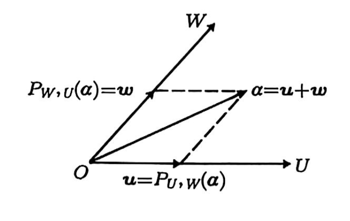

# 第一章 线性空间

- [Back to Course Home](index.md)

## 1.1 线性空间的概念

基础知识见往期笔记：[MATH1205-线性代数/4.线性空间与线性变换](../MATH1205-线性代数/4.线性空间与线性变换.md)

## 1.2 线性子空间
### 线性子空间的概念

概念同样见往期笔记：[MATH1205-线性代数/4.线性空间与线性变换](../MATH1205-线性代数/4.线性空间与线性变换.md/#_3)

### 矩阵的列空间、零空间、行空间和左零化空间

- **定义**：设 $\mathbf{A}_{m\times n} \in \mathbb{F}^{m\times n}$，则

    - $\mathbf{A}$ 的 **列空间** $R(\mathbf{A})$：$\mathbf{A}$ 的列向量生成的空间；

        - $R(\mathbf{A}) = \{\mathbf{A}\boldsymbol{x} \mid \boldsymbol{x} \in \mathbb{F}^n\} = L(\boldsymbol{\alpha}_1, \boldsymbol{\alpha}_2, \ldots, \boldsymbol{\alpha}_n) \subseteq \mathbb{F}^m$

        - $\dim R(\mathbf{A}) = \operatorname{rank}(\mathbf{A})$

    - $\mathbf{A}$ 的 **零化空间** $N(\mathbf{A})$：齐次线性方程组 $\mathbf{A}\boldsymbol{x}=\boldsymbol{0}$ 的解空间；

        - $N(\mathbf{A}) = \{\boldsymbol{x} \in \mathbb{F}^n \mid \mathbf{A}\boldsymbol{x} = \boldsymbol{0}\} \subseteq \mathbb{F}^n$

        - $\dim N(\mathbf{A}) = n - \operatorname{rank}(\mathbf{A})$

    - $\mathbf{A}$ 的 **行空间** $R(\mathbf{A}^{\top})$：$\mathbf{A}$ 的行向量生成的空间；

        - $R(\mathbf{A}^{\top}) = \{\mathbf{A}^{\top}\boldsymbol{y} \mid \boldsymbol{y} \in \mathbb{F}^m\} = L(\boldsymbol{\beta}_1, \boldsymbol{\beta}_2, \ldots, \boldsymbol{\beta}_m) \subseteq \mathbb{F}^n$

        - $\dim R(\mathbf{A}^{\top}) = \operatorname{rank}(\mathbf{A})$

    - $\mathbf{A}$ 的 **左零化空间** $N(\mathbf{A}^{\top})$：齐次线性方程组 $\boldsymbol{y}\mathbf{A}=\boldsymbol{0}$ 的解空间；

        - $N(\mathbf{A}^{\top}) = \{\boldsymbol{y} \in \mathbb{F}^m \mid \boldsymbol{y}\mathbf{A} = \boldsymbol{0}\} \subseteq \mathbb{F}^m$

        - $\dim N(\mathbf{A}^{\top}) = m - \operatorname{rank}(\mathbf{A})$

- **性质**：设 $\mathbf{A}_{m\times n} \in \mathbb{F}^{m\times n}$，构造矩阵 $(\mathbf{I},\mathbf{A})$，经行变换化为 $(\mathbf{P},\mathbf{H}_{\mathbf{A}})$，其中 $\mathbf{I}$ 表示单位矩阵，$\mathbf{H}_{\mathbf{A}}$ 为 $\mathbf{A}$ 的 Hermitian 标准形，则

    - 设 $\mathbf{H}_{\mathbf{A}}$ 中每个非零行的第 $1$ 个非零元素所在列为 $j_1 < j_2 < \dots < j_r$。从 $\mathbf{A}$ 中挑选出第 $j_1,j_2,\dots,j_r$ 列，这 $r$ 个列向量为 $R(\mathbf{A})$ 的一组基；

    - $\mathbf{H}_{\mathbf{A}} \boldsymbol{x} = \boldsymbol{0}$ 的一个基础解系是 $N(\mathbf{A})$ 的一组基；

    - $\mathbf{H}_{\mathbf{A}}$ 的前 $r$ 个非零行的转置为 $R(\mathbf{A}^{\top})$ 的一组基；

    - 矩阵 $\mathbf{P}$ 的后 $m-r$ 行的转置是 $N(\mathbf{A}^{\top})$ 的一组基。

- **示例**：

    $$
    \mathbf{A}=
    \begin{pmatrix}
    3 & -1 & 3 & 2 & 5 \\
    5 & -3 & 2 & 3 & 4 \\
    1 & -3 & -5 & 0 & -7 \\
    2 & -2 & -1 & 1 & -1
    \end{pmatrix}
    $$

    左边添加单位矩阵 $\mathbf{I}$，构造矩阵 $(\mathbf{I},\mathbf{A})$

    $$
    (\mathbf{I},\mathbf{A})=
    \left(
    \begin{array}{cccc|ccccc}
    1 & 0 & 0 & 0 & 3 & -1 & 3 & 2 & 5 \\
    0 & 1 & 0 & 0 & 5 & -3 & 2 & 3 & 4 \\
    0 & 0 & 1 & 0 & 1 & -3 & -5 & 0 & -7 \\
    0 & 0 & 0 & 1 & 2 & -2 & -1 & 1 & -1
    \end{array}
    \right)
    $$

    经过行变换化为 $(\mathbf{P},\mathbf{H}_{\mathbf{A}})$，其中 $\mathbf{H}_{\mathbf{A}}$ 为 $\mathbf{A}$ 的 Hermitian 标准形

    $$
    (\mathbf{P},\mathbf{H}_{\mathbf{A}})=
    \left(
    \begin{array}{cccc|ccccc}
    0 & 0 & -\frac12 & \frac34 & 1 & 0 & \frac74 & \frac34 & \frac{11}{4} \\[2mm]
    0 & 0 & -\frac12 & \frac14 & 0 & 1 & \frac94 & \frac14 & \frac{13}{4} \\[2mm]
    1 & 0 & 1 & -2 & 0 & 0 & 0 & 0 & 0 \\
    0 & 1 & 1 & -3 & 0 & 0 & 0 & 0 & 0
    \end{array}
    \right)
    $$

    则有

    - 列空间 $R(\mathbf{A})$ 的一组基为

        $$
        \begin{pmatrix} 3 \\ 5 \\ 1 \\ 2 \end{pmatrix},
        \begin{pmatrix} -1 \\ -3 \\ -3 \\ -2 \end{pmatrix}
        $$

    - 零化空间 $N(\mathbf{A})$ 的一组基为

        $$
        \begin{pmatrix} -\frac74 \\[2mm] -\frac94 \\[2mm] 1 \\ 0 \\ 0 \end{pmatrix},
        \begin{pmatrix} -\frac34 \\[2mm] -\frac14 \\[2mm] 0 \\ 1 \\ 0 \end{pmatrix},
        \begin{pmatrix} -\frac{11}{4} \\[2mm] -\frac{13}{4} \\[2mm] 0 \\ 0 \\ 1 \end{pmatrix}
        $$

    - 行空间 $R(\mathbf{A}^{\top})$ 的一组基为

        $$
        \begin{pmatrix} 1 & 0 & \frac74 & \frac34 & \frac{11}{4} \end{pmatrix},
        \begin{pmatrix} 0 & 1 & \frac94 & \frac14 & \frac{13}{4} \end{pmatrix}
        $$

    - 左零化空间 $N(\mathbf{A}^{\top})$ 的一组基为

        $$
        \begin{pmatrix} 1 & 0 & 1 & -2 \end{pmatrix},
        \begin{pmatrix} 0 & 1 & 1 & -3 \end{pmatrix}
        $$

### 线性子空间的交与和

- 设 $V$ 是数域 $\mathbb{F}$ 上的线性空间，若 $U$ 是 $V$ 的子空间，$W$ 是 $U$ 的子空间，则 $W$ 是 $V$ 的子空间

- **子空间的交**：设 $V$ 是数域 $\mathbb{F}$ 上的线性空间，$V$ 的任意多个子空间的交仍是 $V$ 的子空间，称为子空间的交。

    - 特别地，对于 $V$ 中的任意两个子空间 $U$ 和 $W$ 而言：

        - $U\cap W$ 仍是子空间

        - $U\cup W$ 不一定是子空间：$U\cup W$ 为子空间 $\iff U\subseteq W$ 或 $W\subseteq U$。

    - 子空间的交是包含在这些子空间中的最大子空间。

- **子空间的和**：设 $V$ 是数域 $\mathbb{F}$ 上的线性空间，$U$ 和 $W$ 是 $V$ 的两个子空间。令

    $$
    U+W=\{\boldsymbol{u}+\boldsymbol{w}\mid \boldsymbol{u}\in U,\boldsymbol{w}\in W\},
    $$

    则对于 $V$ 上的加法和纯量乘法运算，$U+W$ 也是 $V$ 的子空间，称为 $U$ 与 $W$ 的和。

## 1.3 线性空间的分解
### 线性子空间的直和

- **维数定理**：设 $V$ 是数域 $\mathbb{F}$ 上的线性空间，$U$ 和 $W$ 是 $V$ 的两个子空间，则

    $$
    \dim(U+W)=\dim U+\dim W-\dim(U\cap W)
    $$

- **直和**：设 $V$ 是数域 $\mathbb{F}$ 上的线性空间，$U$ 和 $W$ 是 $V$ 的两个子空间，若 $\dim(U\cap W)=0$，则称 $U$ 与 $W$ 的和为直和，记为 $U\oplus W$。

    - 也可以说，若 $U\cap W=\{\boldsymbol{0}\}$，则称 $U$ 与 $W$ 的和为直和。

- **直和的判定**：设 $V$ 是数域 $\mathbb{F}$ 上的线性空间，$U$ 和 $W$ 是 $V$ 的两个子空间，则下列陈述等价。

    1. $U+W$ 是直和；

    2. $U\cap W=\{\boldsymbol{0}\}$；

    3. 对任意 $\boldsymbol{\alpha} \in U+W$，存在唯一的一组向量 $(\boldsymbol{u},\boldsymbol{w})$，其中 $\boldsymbol{u} \in U$ 和 $\boldsymbol{w} \in W$，使得 $\boldsymbol{\alpha} = \boldsymbol{u} + \boldsymbol{w}$；

    4. 若 $\boldsymbol{0} = \boldsymbol{u} + \boldsymbol{w}$，其中 $\boldsymbol{u} \in U$ 和 $\boldsymbol{w} \in W$，则 $\boldsymbol{u} = \boldsymbol{w} = \boldsymbol{0}$；

    5. $\dim(U+W) = \dim U + \dim W$。

- **多子空间直和的判定**：设 $V$ 是数域 $\mathbb{F}$ 上的线性空间，$U_1,\dots,U_k$ 是 $V$ 的子空间。则下列陈述等价：

    1. $U_1+\dots+U_k$ 是直和，记作 $U_1 \oplus \dots \oplus U_k$；

    2. 对每一个 $i=1,2,\dots,k$，都有 $\dim\left(U_i \cap \sum\limits_{j\neq i} U_j\right) = 0$；

    3. 零向量的分解式唯一。

    4. 任意向量 $\boldsymbol{\alpha} \in U_1+\dots+U_k$，即存在 $\boldsymbol{u}_i \in U_i$，我们有分解式 $\boldsymbol{\alpha} = \boldsymbol{u}_1 + \dots + \boldsymbol{u}_k$，则分解式唯一；

    5. $\dim(U_1+\dots+U_k) = \dim U_1 + \dots + \dim U_k$；

- 设 $\mathbf{A}$ 为 $n$ 阶复矩阵，$\lambda_1,\dots,\lambda_k$ 为 $\mathbf{A}$ 的不同特征值，则

    $$
    V_{\lambda_i} = \{\boldsymbol{x} \in \mathbb{C}^n \mid \mathbf{A}\boldsymbol{x} = \lambda_i \boldsymbol{x}\}
    $$

    为 $\mathbf{A}$ 的 $\lambda_i$ 特征值对应的特征子空间。若 $\mathbf{A}$ 可相似对角化，则

    $$
    V_{\lambda_1} \oplus \dots \oplus V_{\lambda_k} = \mathbb{C}^n
    $$

### 线性子空间的补空间

- **补空间**：设 $V$ 是数域 $\mathbb{F}$ 上的线性空间，$U$ 是 $V$ 的一个子空间。那么一定存在 $V$ 的子空间 $W$ 使得 $V = U \oplus W$，称 $W$ 是 $U$ 在 $V$ 中的补空间。

### 向量在子空间上的投影

- **投影**：设 $V$ 是线性空间，$U$ 和 $W$ 是 $V$ 的互补子空间，即 $V = W \oplus U$。这样，对任意的 $\boldsymbol{\alpha} \in V$，都存在唯一的 $\boldsymbol{u} \in U$，$\boldsymbol{w} \in W$，使得 $\boldsymbol{\alpha} = \boldsymbol{u} + \boldsymbol{w}$。称 $\boldsymbol{u}$ 为向量 $\boldsymbol{\alpha}$ 沿子空间 $W$ 在子空间 $U$ 上的投影，记作 $P_{U,W}(\boldsymbol{\alpha})$，如下图所示：
    

- **投影的性质**：设 $V$ 是线性空间，$U$ 和 $W$ 是 $V$ 的互补子空间。则

    1. 对任意的 $\boldsymbol{u} \in U$，都有 $P_{U,W}(\boldsymbol{u}) = \boldsymbol{u}$；

    2. 对任意的 $\boldsymbol{w} \in W$，都有 $P_{U,W}(\boldsymbol{w}) = \boldsymbol{0}$；

    3. 对任意的 $\boldsymbol{\alpha} \in V$，都有 $P_{U,W}(\boldsymbol{\alpha}) + P_{W,U}(\boldsymbol{\alpha}) = \boldsymbol{\alpha}$；

        - $P_{U,W}+P_{W,U}=\mathbf{I}$

    4. 对任意的 $\boldsymbol{\alpha} \in V$，都有 $P_{U,W}(P_{U,W}(\boldsymbol{\alpha})) = P_{U,W}(\boldsymbol{\alpha})$；

        - $P_{U,W}^2 = P_{U,W}$

    5. 对任意的 $\boldsymbol{\alpha} \in V$，都有 $P_{U,W}(P_{W,U}(\boldsymbol{\alpha})) = \boldsymbol{0}$。

        - $P_{U,W}\circ P_{W,U}=0$

- **投影矩阵**：如果存在 $\mathbb{F}^n$ 中互补的两个子空间 $U$ 和 $W$，对任意的 $\boldsymbol{\alpha} \in \mathbb{F}^n$，都有 $\mathbf{A}\boldsymbol{\alpha} = P_{U,W}(\boldsymbol{\alpha})$，那么称方阵 $\mathbf{A}$ 为沿子空间 $W$ 在子空间 $U$ 上的投影矩阵，简称投影矩阵。

- **幂等矩阵**：设 $\mathbf{A}$ 是 $n$ 阶方阵。如果 $\mathbf{A}$ 满足 $\mathbf{A}^2 = \mathbf{A}$，那么称 $\mathbf{A}$ 为幂等矩阵。

    - **定理**：设 $\mathbf{A}$ 是数域 $\mathbb{F}$ 上的 $n$ 阶幂等矩阵，$U$ 是 $\mathbf{A}$ 的对应到特征值 $1$ 的特征子空间，$W$ 是 $\mathbf{A}$ 的对应到特征值 $0$ 的特征子空间。那么

        1. $U$ 恰好是 $\mathbf{A}$ 的列空间，$W$ 恰好是 $\mathbf{A}$ 的零空间，即 $U = R(\mathbf{A}), W = N(\mathbf{A})$。

        2. $\mathbb{F}^n = U \oplus W$。

- **幂等矩阵与投影矩阵**：设 $\mathbf{A}$ 为数域 $\mathbb{F}$ 上的 $n$ 阶方阵，当且仅当 $\mathbf{A}$ 是幂等矩阵时，矩阵 $\mathbf{A}$ 为投影矩阵。

- **定理**：设 $U$ 和 $W$ 是 $n$ 维列向量线性空间 $\mathbb{F}^n$ 中互补的子空间，$\boldsymbol{u}_1,\dots,\boldsymbol{u}_r$ 是 $U$ 的一组基，$\boldsymbol{w}_1,\dots,\boldsymbol{w}_{n-r}$ 是 $W$ 的一组基。令 $\mathbf{X}=(\boldsymbol{u}_1,\dots,\boldsymbol{u}_r)$ 为 $n\times r$ 矩阵，$\mathbf{Y}=(\boldsymbol{w}_1,\dots,\boldsymbol{w}_{n-r})$ 为 $n\times(n-r)$ 矩阵，则

    $$
    P_{U,W}=(\mathbf{X},\mathbf{0})(\mathbf{X},\mathbf{Y})^{-1}
    $$

    为沿子空间 $W$ 在子空间 $U$ 上的投影矩阵，且这个矩阵是唯一的。且

    $$
    P_{U,W} + P_{W,U} = \mathbf{I}
    $$

## 1.4 内积空间
### 内积空间的定义与基本性质

- **内积与内积空间**：设 $\mathbb{F}$ 为实数域 $\mathbb{R}$ 或复数域 $\mathbb{C}$，$V$ 为 $\mathbb{F}$ 上的一个线性空间。对 $V$ 中的任意一对向量 $\boldsymbol{\alpha}$ 与 $\boldsymbol{\beta}$，若存在唯一的 $(\boldsymbol{\alpha},\boldsymbol{\beta})\in \mathbb{F}$ 满足以下性质，则称 $(\boldsymbol{\alpha},\boldsymbol{\beta})$ 为向量 $\boldsymbol{\alpha}$ 与 $\boldsymbol{\beta}$ 的内积。定义了内积的线性空间 $V$ 称之为内积空间。

    1. **共轭对称性**：$(\boldsymbol{\alpha},\boldsymbol{\beta})=\overline{(\boldsymbol{\beta},\boldsymbol{\alpha})},\ \forall\boldsymbol{\alpha},\boldsymbol{\beta}\in V$，其中 $\overline{(\boldsymbol{\beta},\boldsymbol{\alpha})}$ 是复数 $(\boldsymbol{\beta},\boldsymbol{\alpha})$ 的共轭

    2. **线性性**：

        - 关于第一个变量线性：$(k\boldsymbol{\alpha}+l\boldsymbol{\beta},\boldsymbol{\gamma})=k(\boldsymbol{\alpha},\boldsymbol{\gamma})+l(\boldsymbol{\beta},\boldsymbol{\gamma}),\ \forall k,l\in \mathbb{F},\boldsymbol{\alpha},\boldsymbol{\beta},\boldsymbol{\gamma}\in V$

        - 关于第二个变量共轭线性：$(\boldsymbol{\alpha},k\boldsymbol{\beta}+l\boldsymbol{\gamma})=\overline{k}(\boldsymbol{\alpha},\boldsymbol{\beta})+\overline{l}(\boldsymbol{\alpha},\boldsymbol{\gamma}),\ \forall k,l\in \mathbb{F},\boldsymbol{\alpha},\boldsymbol{\beta},\boldsymbol{\gamma}\in V$

    3. **正定性**：$\forall \boldsymbol{\alpha}\in V$，$(\boldsymbol{\alpha},\boldsymbol{\alpha})\ge0$，且 $(\boldsymbol{\alpha},\boldsymbol{\alpha})=0 \iff \boldsymbol{\alpha}=\boldsymbol{0}$

- 常见的内积：

    - **标准内积**：设 $V = \mathbb{C}^n$，$\boldsymbol{\alpha}=(\alpha_1,\dots,\alpha_n)^\top$，$\boldsymbol{\beta}=(\beta_1,\dots,\beta_n)^\top$，则定义标准内积为

        $$
        (\boldsymbol{\alpha},\boldsymbol{\beta})=\sum_{i=1}^n \alpha_i\overline{\beta_i} = \overline{\boldsymbol{\beta}}^{\top} \boldsymbol{\alpha}
        $$

    - **标准欧式内积**：设 $V = \mathbb{R}^n$，$\boldsymbol{\alpha}=(\alpha_1,\dots,\alpha_n)^\top$，$\boldsymbol{\beta}=(\beta_1,\dots,\beta_n)^\top$，则定义标准欧式内积为

        $$
        (\boldsymbol{\alpha},\boldsymbol{\beta})=\sum_{i=1}^n \alpha_i\beta_i = \boldsymbol{\beta}^{\top} \boldsymbol{\alpha}
        $$

- **向量的长度**：设 $V$ 是内积空间，$\boldsymbol{\alpha}\in V$，则定义 $\boldsymbol{\alpha}$ 的长度为

    $$
    \lVert\boldsymbol{\alpha}\rVert=\sqrt{(\boldsymbol{\alpha},\boldsymbol{\alpha})}
    $$

    - **单位向量**：若 $\lVert\boldsymbol{\alpha}\rVert=1$，则称 $\boldsymbol{\alpha}$ 为单位向量。

    - **向量的单位化**：设 $\boldsymbol{\alpha}\in V$，$\boldsymbol{\alpha}\ne \boldsymbol{0}$，令

        $$
        \boldsymbol{\alpha}^0=\frac{1}{\lVert\boldsymbol{\alpha}\rVert}\boldsymbol{\alpha}
        $$

        则 $\boldsymbol{\alpha}^0$ 为单位向量，称这一构造方法为向量的单位化。

- **向量的距离**：设 $V$ 是内积空间，$\boldsymbol{\alpha},\boldsymbol{\beta}\in V$，则定义 $\boldsymbol{\alpha}$ 与 $\boldsymbol{\beta}$ 的距离为

    $$
    d(\boldsymbol{\alpha},\boldsymbol{\beta})=\lVert\boldsymbol{\alpha}-\boldsymbol{\beta}\rVert
    $$

- **性质**：

    1. $\lVert k\boldsymbol{\alpha}\rVert = |k|\cdot\lVert\boldsymbol{\alpha}\rVert$，$\forall k \in \mathbb{F},\boldsymbol{\alpha}\in V$

    2. $\lVert\boldsymbol{\alpha}\rVert \ge 0$，且 $\lVert\boldsymbol{\alpha}\rVert = 0 \iff \boldsymbol{\alpha} = \boldsymbol{0}$，$\forall \boldsymbol{\alpha}\in V$

    3. **柯西-施瓦茨不等式**：$\forall \boldsymbol{\alpha},\boldsymbol{\beta}\in V$，有

        $$
        |(\boldsymbol{\alpha},\boldsymbol{\beta})| \le \lVert\boldsymbol{\alpha}\rVert \cdot \lVert\boldsymbol{\beta}\rVert
        $$

        当且仅当 $\boldsymbol{\alpha}$ 与 $\boldsymbol{\beta}$ 线性相关时，等号成立。

    4. **三角不等式**：$\forall \boldsymbol{\alpha},\boldsymbol{\beta}\in V$，有

        $$
        \lVert\boldsymbol{\alpha}+\boldsymbol{\beta}\rVert \le \lVert\boldsymbol{\alpha}\rVert + \lVert\boldsymbol{\beta}\rVert
        $$

        当且仅当 $\boldsymbol{\alpha}$ 与 $\boldsymbol{\beta}$ 线性相关时，等号成立。

### 标准正交基

- **向量夹角**：设 $V$ 是内积空间，$\boldsymbol{\alpha},\boldsymbol{\beta}\in V$，且 $\boldsymbol{\alpha}\ne \boldsymbol{0}$，$\boldsymbol{\beta}\ne \boldsymbol{0}$。定义 $\boldsymbol{\alpha}$ 与 $\boldsymbol{\beta}$ 的夹角为

    $$
    \langle \boldsymbol{\alpha}, \boldsymbol{\beta} \rangle = \arccos\frac{|(\boldsymbol{\alpha},\boldsymbol{\beta})|}{\lVert\boldsymbol{\alpha}\rVert\cdot\lVert\boldsymbol{\beta}\rVert}
    $$

    - **向量正交**：特别地，若 $\langle \boldsymbol{\alpha}, \boldsymbol{\beta} \rangle = \frac{\pi}{2}$，即 $(\boldsymbol{\alpha},\boldsymbol{\beta}) = 0$，则称 $\boldsymbol{\alpha}$ 与 $\boldsymbol{\beta}$ 正交，记作 $\boldsymbol{\alpha}\perp\boldsymbol{\beta}$

    - 零向量 $\boldsymbol{0}$ 与任意向量正交。

- **正交向量组**：设 $\boldsymbol{\alpha}_1,\dots,\boldsymbol{\alpha}_n$ 为内积空间 $V$ 中的一组非零向量。若 $\forall i\ne j$，$\boldsymbol{\alpha}_i\perp\boldsymbol{\alpha}_j$，则称 $\boldsymbol{\alpha}_1,\dots,\boldsymbol{\alpha}_n$ 为 $V$ 中的正交向量组。

    - **标准正交向量组**：若正交向量组中的每个向量都是单位向量，则称该正交向量组为标准正交向量组。

    - 正交向量组中的向量都是线性无关的。

- **正交基**：设 $\boldsymbol{\epsilon}_1,\dots,\boldsymbol{\varepsilon}_n$ 为内积空间 $V$ 中的一组基。若 $\boldsymbol{\varepsilon}_1,\dots,\boldsymbol{\varepsilon}_n$ 为正交向量组，则称 $\boldsymbol{\varepsilon}_1,\dots,\boldsymbol{\varepsilon}_n$ 为 $V$ 的正交基。

    - **标准正交基**：若正交基中的每个向量都是单位向量，则称该正交基为标准正交基。

    - **性质**：

        $$
        (\boldsymbol{\epsilon}_i,\boldsymbol{\epsilon}_j) = \delta_{ij} = \begin{cases} 1, & i=j \\ 0, & i\ne j \end{cases}, \quad i,j=1,2,\dots,n
        $$

- **施密特正交化过程**：设 $\boldsymbol{\alpha}_1,\dots,\boldsymbol{\alpha}_n$ 为内积空间 $V$ 中的一组线性无关向量，则可以通过以下过程构造出一组标准正交向量组 $\boldsymbol{\epsilon}_1,\dots,\boldsymbol{\epsilon}_n$：

    1. 令 $\boldsymbol{\epsilon}_1^0 = \frac{1}{\lVert\boldsymbol{\alpha}_1\rVert}\boldsymbol{\alpha}_1$；

    2. 对 $k=2,3,\dots,n$，令

        $$
        \boldsymbol{\epsilon}_k = \boldsymbol{\alpha}_k - \sum_{i=1}^{k-1} (\boldsymbol{\alpha}_k,\boldsymbol{\epsilon}_i^0)\boldsymbol{\epsilon}_i^0
        $$

        并令 $\boldsymbol{\epsilon}_k^0 = \frac{1}{\lVert\boldsymbol{\epsilon}_k\rVert}\boldsymbol{\epsilon}_k$。

### 酉矩阵

- **酉矩阵**：设 $\mathbf{U}_n \in \mathbb{C}^{n\times n}$ 为 $n$ 阶复矩阵。若 $\mathbf{U}$ 的列向量组是标准正交基，则称 $\mathbf{U}$ 为酉矩阵。

    - **正交矩阵**：特别地，若 $\mathbf{U}$ 为实矩阵，则称 $\mathbf{U}$ 为正交矩阵。

    - **共轭转置**：记 $\mathbf{U}^{*} = \overline{\mathbf{U}^{\top}} = \overline{\mathbf{U}}^{\top}$

    - **性质**：

        - 酉矩阵 $\mathbf{U}$ 的行列式的模为 $1$，即 $|\det(\mathbf{U})|=1$。

        - 若 $\mathbf{A}$ 和 $\mathbf{B}$ 都是酉矩阵，则 $\mathbf{A}\mathbf{B}$ 也是酉矩阵。

- **定理**：设 $\mathbf{U}$ 为 $n$ 阶复矩阵，则下列陈述等价：

    1. $\mathbf{U}$ 为酉矩阵

    2. $\mathbf{U}^{*}\mathbf{U} = \mathbf{U}\mathbf{U}^{*} = \mathbf{I}$

    3. $\mathbf{U}^{-1} = \mathbf{U}^{*}$

    4. $\mathbf{U}^{-1}$ 和 $\mathbf{U}^{*}$ 都是酉矩阵

### Hermitian 矩阵

- **定义**：设 $\mathbf{A}_n \in \mathbb{C}^{n\times n}$。

    - **Hermitian 矩阵**：$\mathbf{A} = \mathbf{A}^{*}$

        - **实对称矩阵**：特别地，若 $\mathbf{A}$ 为实矩阵，则称 $\mathbf{A}$ 为实对称矩阵

    - **反 Hermitian 矩阵**：$\mathbf{A} = -\mathbf{A}^{*}$

        - **实反对称矩阵**：特别地，若 $\mathbf{A}$ 为实矩阵，则称 $\mathbf{A}$ 为实反对称矩阵

- **性质**：

    1. Hermitian 矩阵的特征值都是实数。

    2. Hermitian 矩阵的不同特征值对应的特征向量是正交的。

    3. Hermitian 矩阵可以酉相似对角化，即存在酉矩阵 $\mathbf{U}$，使得 $\mathbf{U}^{*}\mathbf{A}\mathbf{U}$ 为对角矩阵。

- **复二次型**：设 $\boldsymbol{x}=(x_1, x_2, \dots, x_n)^\top$ 是未定元向量，$\mathbf{A}_n \in \mathbb{C}^{n\times n}$。称关于 $x_1, \dots, x_n$ 与 $\overline{x_1}, \dots, \overline{x_n}$ 的复系数二次多项式

    $$
    f(\boldsymbol{x})=\sum_{i=1}^n \sum_{j=1}^n a_{ij} \overline{x_i} x_j = \boldsymbol{x}^* \mathbf{A} \boldsymbol{x}
    $$

    为 $n$ 阶复二次型，称 $\mathbf{A}$ 为复二次型 $f(\boldsymbol{x})$ 的矩阵，$\operatorname{rank}(\mathbf{A})$ 也叫作 $f(\boldsymbol{x})$ 的秩。

    - 实部：

        $$
        \operatorname{Re}(f(\boldsymbol{x}))=\boldsymbol{x}^* \frac{\mathbf{A}+\mathbf{A}^*}{2} \boldsymbol{x}
        $$

    - 虚部：

        $$
        \operatorname{Im}(f(\boldsymbol{x}))=-i \boldsymbol{x}^* \frac{\mathbf{A}-\mathbf{A}^*}{2} \boldsymbol{x}
        $$

- **Hermitian 二次型**：设 $\mathbf{A}_n \in \mathbb{C}^{n\times n}$，$f(\boldsymbol{x})=\boldsymbol{x}^* \mathbf{A} \boldsymbol{x}$ 是一个 $n$ 阶复二次型。若对任意的 $\boldsymbol{x} \in \mathbb{\mathbb{C}}^n$，都有 $f(\boldsymbol{x}) \in \mathbb{\mathbb{R}}$，则称 $f(\boldsymbol{x})$ 为 Hermitian 二次型。

    - **充要条件**：$\mathbf{A}$ 是 Hermitian 矩阵

    - **Hermitian 二次型的标准形**：设 $\mathbf{A}$ 为 $n$ 阶 Hermitian 矩阵。则存在酉矩阵 $\mathbf{U}$，使得 Hermitian 二次型 $f(\boldsymbol{x})=\boldsymbol{x}^* \mathbf{A} \boldsymbol{x}$ 经过非奇异线性替换 $\boldsymbol{x}=\mathbf{U}\boldsymbol{y}$ 化为标准型

        $$
        g(\boldsymbol{y})=\lambda_1 |y_1|^2 + \lambda_2 |y_2|^2 + \dots + \lambda_n |y_n|^2
        $$

        其中 $\lambda_1, \lambda_2, \dots, \lambda_n$ 为矩阵 $\mathbf{A}$ 的 $n$ 个实特征值。

### 正定矩阵

- **正定二次型与正定矩阵**：设 $\mathbf{A}_n \in \mathbb{C}^{n\times n}$，$f(\boldsymbol{x})=\boldsymbol{x}^* \mathbf{A} \boldsymbol{x}$，若对任意的 $\boldsymbol{x} \in \mathbb{\mathbb{C}}^n$，$\boldsymbol{x} \neq \boldsymbol{0}$，都有 $f(\boldsymbol{x})>0$，则称 $f(\boldsymbol{x})$ 为正定二次型，称 $\mathbf{A}$ 为正定矩阵。

- **合同变换保持正定性**：令 $\mathbf{A}_n \in \mathbb{C}^{n\times n}$，$f(\boldsymbol{x})=\boldsymbol{x}^* \mathbf{A} \boldsymbol{x}$ 是 $n$ 阶 Hermitian 二次型，$\mathbf{P}_n$ 可逆，则二次型 $f(\boldsymbol{x})$ 经过非奇异线性替换 $\boldsymbol{x}=\mathbf{P}\boldsymbol{y}$ 化为二次型 $g(\boldsymbol{y})=\boldsymbol{y}^* \mathbf{B} \boldsymbol{y}$ 后正定性保持不变，其中 $\mathbf{B}=\mathbf{P}^* \mathbf{A} \mathbf{P}$。

    - $g(\boldsymbol{y})$ 为正定二次型 $\iff f(\boldsymbol{x})$ 为正定二次型

    - $\mathbf{B}$ 为正定矩阵 $\iff \mathbf{A}$ 为正定矩阵

- **定理**：

    - 设 $\mathbf{A}_n \in \mathbb{C}^{n\times n}$，$f(\boldsymbol{x})=\boldsymbol{x}^* \mathbf{A} \boldsymbol{x}$，则下列陈述等价：

        1. $\mathbf{A}$ 为正定矩阵；

        2. $f(\boldsymbol{x})=\boldsymbol{x}^* \mathbf{A} \boldsymbol{x}$ 为正定二次型；

        3. $\mathbf{A}$ 为 Hermitian 矩阵，且 $n$ 个特征值全大于 $0$；

        4. 存在 $n$ 阶可逆矩阵 $\mathbf{M}$，使得 $\mathbf{A}=\mathbf{M}^* \mathbf{M}$；

        5. 存在 $n$ 阶可逆矩阵 $\mathbf{P}$，使得 $\mathbf{P}^* \mathbf{A} \mathbf{P}=\boldsymbol{\boldsymbol{I}}$；

        6. 存在 $m \times n$ 阶列满秩矩阵 $\mathbf{M}$，使得 $\mathbf{A}=\mathbf{M}^* \mathbf{M}$。

    - **子空间上正定的充要条件**：Hermitian 矩阵 $\mathbf{A}$ 在某个 $k$ 维子空间上正定的充分必要条件是 $\mathbf{A}$ 至少有 $k$ 个特征值（包括重数）大于 $0$。

    - 设 $\mathbf{A}_n \in \mathbb{C}^{n\times n}$，$f(\boldsymbol{x})=\boldsymbol{x}^* \mathbf{A} \boldsymbol{x}$，则当且仅当 $\mathbf{A}$ 为 Hermitian 矩阵，且 $\mathbf{A}$ 的所有顺序主子式均大于 $0$ 时，$\mathbf{A}$ 为正定矩阵。

        - **顺序主子式**：设 $\mathbf{A}_n \in \mathbb{C}^{n\times n}$，$\mathbf{A}_k$ 为 $\mathbf{A}$ 的前 $k$ 行与前 $k$ 列组成的 $k$ 阶子矩阵，则 $\det(\mathbf{A}_k)$ 称为 $\mathbf{A}$ 的第 $k$ 个顺序主子式。

    - 设 $\mathbf{A}_n \in \mathbb{C}^{n\times n}$，$f(\boldsymbol{x})=\boldsymbol{x}^* \mathbf{A} \boldsymbol{x}$，则当且仅当存在正定矩阵 $\mathbf{B}$，使得 $\mathbf{A}=\mathbf{B}^2$ 时，$\mathbf{A}$ 为正定矩阵。

        - **算数平方根**：$\mathbf{B}$ 是唯一的，称 $\mathbf{B}$ 为正定矩阵 $\mathbf{A}$ 的算术平方根。

- **瑞利商最大值**：设 $\mathbf{A}_n \in \mathbb{C}^{n\times n}$，$f(\boldsymbol{x})=\boldsymbol{x}^* \mathbf{A} \boldsymbol{x}$ 是一个 $n$ 阶正定复二次型，$\lambda_{\text{max}}$ 是矩阵 $\mathbf{A}$ 的最大特征值。则对任意的 $\boldsymbol{x} \in \mathbb{\mathbb{C}}^n$，均有

    $$
    \boldsymbol{x}^* \mathbf{A} \boldsymbol{x} \leq \lambda_{\text{max}} \boldsymbol{x}^* \boldsymbol{x}
    $$

    进一步有

    $$
    \max_{\lVert \boldsymbol{x} \rVert=1} \boldsymbol{x}^* \mathbf{A} \boldsymbol{x} = \lambda_{\text{max}}
    $$

- **Cholesky 分解**：设 $\mathbf{A}$ 是 $n$ 阶正定矩阵。存在唯一的对角线元素均大于零的下三角矩阵 $\mathbf{G}$，使得 $\mathbf{A}=\mathbf{G}\mathbf{G}^*$，称矩阵 $\mathbf{G}$ 为 Cholesky 三角。

### 内积与正定矩阵

- **度量矩阵**：设 $V$ 为 $n$ 维内积空间，$\boldsymbol{\varepsilon}_1, \boldsymbol{\varepsilon}_2, \dots, \boldsymbol{\varepsilon}_n$ 是 $V$ 的一组基。对任意 $\boldsymbol{\alpha}, \boldsymbol{\beta} \in V$，设

    $$
    \begin{aligned}
    \boldsymbol{\alpha}&=x_1 \boldsymbol{\varepsilon}_1 + x_2 \boldsymbol{\varepsilon}_2 + \dots + x_n \boldsymbol{\varepsilon}_n = (\boldsymbol{\varepsilon}_1, \boldsymbol{\varepsilon}_2, \dots, \boldsymbol{\varepsilon}_n) \boldsymbol{x} \\
    \boldsymbol{\beta}&=y_1 \boldsymbol{\varepsilon}_1 + y_2 \boldsymbol{\varepsilon}_2 + \dots + y_n \boldsymbol{\varepsilon}_n = (\boldsymbol{\varepsilon}_1, \boldsymbol{\varepsilon}_2, \dots, \boldsymbol{\varepsilon}_n) \boldsymbol{y}
    \end{aligned}
    $$

    其中 $\boldsymbol{x}=(x_1, x_2, \dots, x_n)^\top$ 和 $\boldsymbol{y}=(y_1, y_2, \dots, y_n)^\top$ 分别是向量 $\boldsymbol{\alpha}$ 和 $\boldsymbol{\beta}$ 在该基下的坐标，则内积可表示为

    $$
    (\boldsymbol{\alpha}, \boldsymbol{\beta}) = \sum_{i=1}^n \sum_{j=1}^n x_i \overline{y_j} (\boldsymbol{\varepsilon}_i, \boldsymbol{\varepsilon}_j) = \boldsymbol{y}^* \mathbf{A} \boldsymbol{x}
    $$

    其中矩阵

    $$
    \mathbf{A}=
    \begin{pmatrix}
    (\boldsymbol{\varepsilon}_1, \boldsymbol{\varepsilon}_1) & (\boldsymbol{\varepsilon}_2, \boldsymbol{\varepsilon}_1) & \dots & (\boldsymbol{\varepsilon}_n, \boldsymbol{\varepsilon}_1) \\
    (\boldsymbol{\varepsilon}_1, \boldsymbol{\varepsilon}_2) & (\boldsymbol{\varepsilon}_2, \boldsymbol{\varepsilon}_2) & \dots & (\boldsymbol{\varepsilon}_n, \boldsymbol{\varepsilon}_2) \\
    \vdots & \vdots & & \vdots \\
    (\boldsymbol{\varepsilon}_1, \boldsymbol{\varepsilon}_n) & (\boldsymbol{\varepsilon}_2, \boldsymbol{\varepsilon}_n) & \dots & (\boldsymbol{\varepsilon}_n, \boldsymbol{\varepsilon}_n)
    \end{pmatrix}
    $$

    称为基 $\boldsymbol{\varepsilon}_1, \boldsymbol{\varepsilon}_2, \dots, \boldsymbol{\varepsilon}_n$ 的度量矩阵。

- **正定性**：设 $V$ 为 $n$ 维内积空间，$\boldsymbol{\varepsilon}_1, \boldsymbol{\varepsilon}_2, \dots, \boldsymbol{\varepsilon}_n$ 是 $V$ 的一组基，$\mathbf{A}$ 是该基的度量矩阵，则 $\mathbf{A}$ 是正定矩阵。

    - 若 $\boldsymbol{\varepsilon}_1, \dots, \boldsymbol{\varepsilon}_n$ 为正交基，则度量矩阵 $\mathbf{A}$ 为对角阵

    - 若 $\boldsymbol{\varepsilon}_1, \dots, \boldsymbol{\varepsilon}_n$ 为标准正交基，则度量矩阵 $\mathbf{A} = \mathbf{I}$

- **内积与正定矩阵一一对应**：设 $V$ 为实数域 $\mathbb{\mathbb{R}}$ 或复数域 $\mathbb{\mathbb{C}}$ 上的 $n$ 维线性空间，则 $V$ 上的内积与正定矩阵一一对应。

    - **推论**：设 $V$ 为实数域 $\mathbb{\mathbb{R}}$ 或复数域 $\mathbb{\mathbb{C}}$ 上的 $n$ 维线性空间，$\boldsymbol{\varepsilon}_1, \boldsymbol{\varepsilon}_2, \dots, \boldsymbol{\varepsilon}_n$ 是 $V$ 中一组基，则必存在 $V$ 上的内积，使得 $\boldsymbol{\varepsilon}_1, \boldsymbol{\varepsilon}_2, \dots, \boldsymbol{\varepsilon}_n$ 成为一组标准正交基。

- **基变换下度量矩阵的合同关系**：令 $V$ 为实数域 $\mathbb{\mathbb{R}}$ 或复数域 $\mathbb{\mathbb{C}}$ 上的 $n$ 维内积空间，$\boldsymbol{\alpha}_1, \boldsymbol{\alpha}_2, \dots, \boldsymbol{\alpha}_n$ 和 $\boldsymbol{\beta}_1, \boldsymbol{\beta}_2, \dots, \boldsymbol{\beta}_n$ 是 $V$ 中两组基，对应度量矩阵分别为 $\mathbf{A}$ 和 $\mathbf{B}$，由基 $\boldsymbol{\alpha}_1, \dots, \boldsymbol{\alpha}_n$ 到基 $\boldsymbol{\beta}_1, \dots, \boldsymbol{\beta}_n$ 的过渡矩阵为 $\mathbf{P}$。则矩阵 $\mathbf{A}$ 和 $\mathbf{B}$ 合同，且满足

    $$
    \mathbf{B} = \mathbf{P}^* \mathbf{A} \mathbf{P}
    $$

