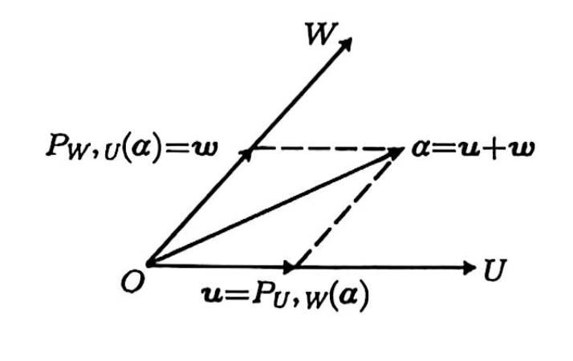
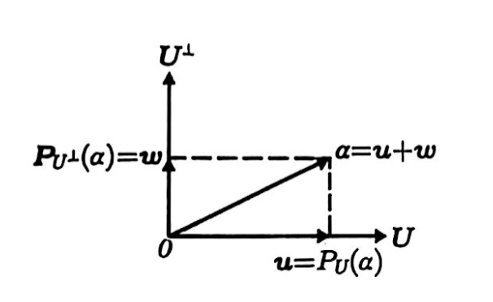

# 第一章 线性空间

## 1.1 线性空间的概念

### 线性空间的定义

- **线性空间**：设 $V$ 为非空集合，$\mathbb{F}$ 为数域。在 $V$ 中定义向量加法，在 $\mathbb{F}$ 与 $V$ 之间定义纯量乘法，且满足：

    - **封闭性**：对任意 $\boldsymbol{\alpha},\boldsymbol{\beta}\in V$ 和 $k\in\mathbb{F}$，$\boldsymbol{\alpha}+\boldsymbol{\beta}$ 与 $k\boldsymbol{\alpha}$ 均为 $V$ 中唯一确定的元素。

    - **加法的运算律**：对任意 $\boldsymbol{\alpha},\boldsymbol{\beta},\boldsymbol{\gamma}\in V$，有

        1. **交换律**：$\boldsymbol{\alpha}+\boldsymbol{\beta}=\boldsymbol{\beta}+\boldsymbol{\alpha}$；

        2. **结合律**：$(\boldsymbol{\alpha}+\boldsymbol{\beta})+\boldsymbol{\gamma}=\boldsymbol{\alpha}+(\boldsymbol{\beta}+\boldsymbol{\gamma})$；

        3. **零元存在性**：存在 $\boldsymbol{0}\in V$，使 $\boldsymbol{\alpha}+\boldsymbol{0}=\boldsymbol{\alpha}$；

        4. **负元存在性**：对每个 $\boldsymbol{\alpha}\in V$，存在 $\boldsymbol{\beta}\in V$，使 $\boldsymbol{\alpha}+\boldsymbol{\beta}=\boldsymbol{0}$。

    - **纯量乘法的运算律**：对任意 $k,l\in\mathbb{F}$ 和 $\boldsymbol{\alpha},\boldsymbol{\beta}\in V$，有

        1. $1\boldsymbol{\alpha}=\boldsymbol{\alpha}$；

        2. $k(l\boldsymbol{\alpha})=(kl)\boldsymbol{\alpha}$；

        3. $(k+l)\boldsymbol{\alpha}=k\boldsymbol{\alpha}+l\boldsymbol{\alpha}$；

        4. $k(\boldsymbol{\alpha}+\boldsymbol{\beta})=k\boldsymbol{\alpha}+k\boldsymbol{\beta}$。

    则称 $V$ 关于上述运算构成数域 $\mathbb{F}$ 上的线性空间，$V$ 中的元素统称为向量。

    - $\mathbb{F}=\mathbb{R}$ 时称为 **实线性空间**；$\mathbb{F}=\mathbb{C}$ 时称为 **复线性空间**。

    - 线性空间不仅取决于元素集合，还取决于数域及所定义的加法、纯量乘法。

- **常见的线性空间**：以下均取通常的加法和纯量乘法。

    - **向量空间** $\mathbb{F}^n$：数域 $\mathbb{F}$ 上全体 $n$ 维列向量组成的集合。

    - **矩阵空间** $\mathbb{F}^{m\times n}$：数域 $\mathbb{F}$ 上全体 $m\times n$ 矩阵组成的集合。

    - **连续函数空间** $C[a,b]$：区间 $[a,b]$ 上全体实值连续函数组成的集合，为实线性空间。

    - **多项式空间** $\mathbb{F}[x]$：数域 $\mathbb{F}$ 上全体一元多项式组成的集合。

    - **次数受限的多项式空间**：次数不超过 $n-1$ 的多项式及零多项式组成的空间

        $$
        \mathbb{F}[x]_n=\left\{a_0+a_1x+\cdots+a_{n-1}x^{n-1}\mid a_0,\dots,a_{n-1}\in\mathbb{F}\right\}
        $$

    - **可微函数空间** $D^{(n)}[a,b]$：区间 $[a,b]$ 上全体 $n$ 次可微实函数组成的实线性空间。

    - **复数构成的实线性空间**：$\mathbb{C}$ 关于复数加法及实数与复数的乘法，构成 $\mathbb{R}$ 上的线性空间。

### 线性空间的简单性质

1. **零元唯一**：线性空间 $V$ 的零向量唯一，记作 $\boldsymbol{0}$；

2. **负元唯一**：每个 $\boldsymbol{\alpha}\in V$ 的负向量唯一，记为 $-\boldsymbol{\alpha}$；

3. $\forall \boldsymbol{\alpha}\in V$，有 $\boldsymbol{0\alpha}=\boldsymbol{0}$，$(-1)\boldsymbol{\alpha}=-\boldsymbol{\alpha}$；

4. $\forall k\in\mathbb{F}$，有 $k\boldsymbol{0}=\boldsymbol{0}$；

5. 若 $k\boldsymbol{\alpha}=\boldsymbol{0}$，则 $k=0$ 或 $\boldsymbol{\alpha}=\boldsymbol{0}$。

### 线性空间的基底、维数与向量的坐标

- **线性组合与线性表示**：设 $V$ 为数域 $\mathbb{F}$ 上的线性空间，$\boldsymbol{\alpha}_1,\dots,\boldsymbol{\alpha}_s\in V$，$k_1,\dots,k_s\in\mathbb{F}$，则

    $$
    k_1\boldsymbol{\alpha}_1+\cdots+k_s\boldsymbol{\alpha}_s
    $$

    称为这些向量的线性组合。若 $\boldsymbol{\beta}$ 等于上述线性组合，则称 $\boldsymbol{\beta}$ 可由 $\boldsymbol{\alpha}_1,\dots,\boldsymbol{\alpha}_s$ 线性表示。

- **线性相关与线性无关**：若存在不全为零的 $k_1,\dots,k_s\in\mathbb{F}$，使

    $$
    k_1\boldsymbol{\alpha}_1+\cdots+k_s\boldsymbol{\alpha}_s=\boldsymbol{0},
    $$

    则称 $\boldsymbol{\alpha}_1,\dots,\boldsymbol{\alpha}_s$ 线性相关；否则称为线性无关。

    - **线性无关的判定**：上式只有零解 $k_1=\cdots=k_s=0$。

    - **说明**：

        - 含零向量的向量组必线性相关；

        - 单向量组线性无关当且仅当该向量非零。

- **基底与维数**：设 $V$ 为数域 $\mathbb{F}$ 上的线性空间，若 $\boldsymbol{\alpha}_1,\dots,\boldsymbol{\alpha}_n\in V$ 满足

    1. $\boldsymbol{\alpha}_1,\dots,\boldsymbol{\alpha}_n$ 线性无关

    2. $V$ 中任意向量均可由 $\boldsymbol{\alpha}_1,\dots,\boldsymbol{\alpha}_n$ 线性表示

    则称这组向量为 $V$ 的一组 **基底**，简称基。基中向量的个数 $n$ 称为 $V$ 的 **维数**，记为 $\dim_{\mathbb{F}}V=n$，不引起混淆时简记为 $\dim V=n$。

    - **零空间**：约定 $\dim\{\boldsymbol{0}\}=0$，其基可取为空向量组。

    - **有限维与无限维**：存在有限基的空间称为有限维线性空间；不存在有限基的空间称为无限维线性空间。

    - **基的判定**：在 $n$ 维线性空间中，任意 $n$ 个线性无关的向量构成一组基；任意 $n$ 个张成整个空间的向量也构成一组基。

- **常见空间的基与维数**：

    - $\mathbb{F}^n$ 的标准基为 $\boldsymbol{e}_1,\dots,\boldsymbol{e}_n$，$\dim\mathbb{F}^n=n$。

    - $\mathbb{F}^{m\times n}$ 的一组基为全体基本矩阵 $\mathbf{E}_{ij}$（第 $i$ 行第 $j$ 列为 $1$，其余位置为 $0$），$\dim\mathbb{F}^{m\times n}=mn$。

    - $\mathbb{F}[x]_n$ 的一组基为 $1,x,\dots,x^{n-1}$，$\dim\mathbb{F}[x]_n=n$。

    - $\mathbb{F}[x]$ 为无限维线性空间，一组基为 $1,x,x^2,\dots$；每个多项式均为其中有限个元素的线性组合。

    - **说明**：$\dim_{\mathbb{R}}\mathbb{C}=2$，可取基 $1,\mathrm{i}$；$\dim_{\mathbb{C}}\mathbb{C}=1$，可取基 $1$。

- **向量的坐标**：设 $\boldsymbol{\alpha}_1,\dots,\boldsymbol{\alpha}_n$ 为 $V$ 的一组有序基。任意 $\boldsymbol{\gamma}\in V$ 均可唯一表示为

    $$
    \boldsymbol{\gamma}=x_1\boldsymbol{\alpha}_1+\cdots+x_n\boldsymbol{\alpha}_n
    =(\boldsymbol{\alpha}_1,\dots,\boldsymbol{\alpha}_n)\boldsymbol{x},\qquad
    \boldsymbol{x}=\begin{pmatrix}x_1\\\vdots\\x_n\end{pmatrix}
    $$

    称 $\boldsymbol{x}$ 为 $\boldsymbol{\gamma}$ 在该基下的坐标。

### 基变换与坐标变换

- **过渡矩阵**：设 $\boldsymbol{\alpha}_1,\dots,\boldsymbol{\alpha}_n$ 与 $\boldsymbol{\beta}_1,\dots,\boldsymbol{\beta}_n$ 为 $n$ 维线性空间 $V$ 的两组基，且

    $$
    (\boldsymbol{\beta}_1,\dots,\boldsymbol{\beta}_n)
    =(\boldsymbol{\alpha}_1,\dots,\boldsymbol{\alpha}_n)\mathbf{P}
    $$

    则称 $\mathbf{P}$ 为由基 $\boldsymbol{\alpha}_1,\dots,\boldsymbol{\alpha}_n$ 到基 $\boldsymbol{\beta}_1,\dots,\boldsymbol{\beta}_n$ 的过渡矩阵，上式称为 **基变换公式**。

    - $\mathbf{P}$ 的第 $j$ 列是新基向量 $\boldsymbol{\beta}_j$ 在旧基 $\boldsymbol{\alpha}_1,\dots,\boldsymbol{\alpha}_n$ 下的坐标。

    - 过渡矩阵必可逆，从基 $\boldsymbol{\beta}_1,\dots,\boldsymbol{\beta}_n$ 到基 $\boldsymbol{\alpha}_1,\dots,\boldsymbol{\alpha}_n$ 的过渡矩阵为 $\mathbf{P}^{-1}$。

- **坐标变换公式**：设同一向量 $\boldsymbol{\gamma}$ 在上述两组基下的坐标分别为 $\boldsymbol{x}$ 和 $\boldsymbol{y}$，则

    $$
    \boldsymbol{x}=\mathbf{P}\boldsymbol{y},\qquad
    \boldsymbol{y}=\mathbf{P}^{-1}\boldsymbol{x}
    $$

    - 由

        $$
        \boldsymbol{\gamma}
        =(\boldsymbol{\alpha}_1,\dots,\boldsymbol{\alpha}_n)\boldsymbol{x}
        =(\boldsymbol{\beta}_1,\dots,\boldsymbol{\beta}_n)\boldsymbol{y}
        =(\boldsymbol{\alpha}_1,\dots,\boldsymbol{\alpha}_n)\mathbf{P}\boldsymbol{y}
        $$

        及坐标的唯一性即得。

- **过渡矩阵的计算**：若两组基在同一参考基下的坐标矩阵分别为 $\mathbf{A}$ 和 $\mathbf{B}$，过渡矩阵为 $\mathbf{P}$，则

    $$
    \mathbf{B}=\mathbf{A}\mathbf{P},\qquad
    \mathbf{P}=\mathbf{A}^{-1}\mathbf{B}
    $$

    可通过初等行变换 $(\mathbf{A}\mid\mathbf{B})\longrightarrow(\mathbf{I}\mid\mathbf{P})$ 求解。

## 1.2 线性子空间
### 线性子空间的概念

- **线性子空间**：设 $V$ 为数域 $\mathbb{F}$ 上的线性空间，$W$ 为 $V$ 的非空子集。如果 $W$ 关于 $V$ 中原有的加法和纯量乘法也构成 $\mathbb{F}$ 上的线性空间，则称 $W$ 为 $V$ 的线性子空间，简称子空间。

    - 子空间的数域、加法和纯量乘法必须与原空间一致。

- **子空间的判定**：$V$ 的非空子集 $W$ 是 $V$ 的子空间，当且仅当它对加法和纯量乘法封闭，即

    $$
    \boldsymbol{\alpha},\boldsymbol{\beta}\in W\implies\boldsymbol{\alpha}+\boldsymbol{\beta}\in W,\qquad
    k\in\mathbb{F},\ \boldsymbol{\alpha}\in W\implies k\boldsymbol{\alpha}\in W
    $$

    等价地，对任意 $k,l\in\mathbb{F}$ 和 $\boldsymbol{\alpha},\boldsymbol{\beta}\in W$，都有 $k\boldsymbol{\alpha}+l\boldsymbol{\beta}\in W$。

    - **说明**：其余运算律可从 $V$ 继承；取 $\boldsymbol{\alpha}\in W$，由数乘封闭性得到 $\boldsymbol{0}=0\boldsymbol{\alpha}\in W$、$-\boldsymbol{\alpha}=(-1)\boldsymbol{\alpha}\in W$，从而零元、负元也存在。

    - **必要条件**：子空间一定包含零向量，但仅包含零向量不足以保证是子空间。

- **平凡子空间**：零子空间 $\{\boldsymbol{0}\}$ 与全空间 $V$ 均为 $V$ 的子空间，统称为平凡子空间。

- **生成子空间**：设 $\boldsymbol{\alpha}_1,\dots,\boldsymbol{\alpha}_m\in V$，它们的全体线性组合组成的集合

    $$
    L(\boldsymbol{\alpha}_1,\dots,\boldsymbol{\alpha}_m)
    =\left\{\sum_{i=1}^m k_i\boldsymbol{\alpha}_i\mid k_1,\dots,k_m\in\mathbb{F}\right\}
    $$

    为 $V$ 的子空间，称为这些向量生成的子空间。（有时也记作 $\operatorname{span}\{\boldsymbol{\alpha}_1,\dots,\boldsymbol{\alpha}_m\}$）

    - 若 $\boldsymbol{\alpha}_{i_1},\dots,\boldsymbol{\alpha}_{i_r}$ 是生成向量组的一个极大线性无关组，则它们构成该子空间的一组基，故

        $$
        \dim L(\boldsymbol{\alpha}_1,\dots,\boldsymbol{\alpha}_m)=\operatorname{rank}(\boldsymbol{\alpha}_1,\dots,\boldsymbol{\alpha}_m)
        $$

### 矩阵的列空间、零空间、行空间和左零化空间

- **定义**：设 $\mathbf{A}_{m\times n} \in \mathbb{F}^{m\times n}$，则

    - $\mathbf{A}$ 的 **列空间** $R(\mathbf{A})$：$\mathbf{A}$ 的列向量生成的空间；

        - $R(\mathbf{A}) = \{\mathbf{A}\boldsymbol{x} \mid \boldsymbol{x} \in \mathbb{F}^n\} = L(\boldsymbol{\alpha}_1, \boldsymbol{\alpha}_2, \ldots, \boldsymbol{\alpha}_n) \subseteq \mathbb{F}^m$

        - $\dim R(\mathbf{A}) = \operatorname{rank}(\mathbf{A})$

    - $\mathbf{A}$ 的 **零化空间** $N(\mathbf{A})$：齐次线性方程组 $\mathbf{A}\boldsymbol{x}=\boldsymbol{0}$ 的解空间；

        - $N(\mathbf{A}) = \{\boldsymbol{x} \in \mathbb{F}^n \mid \mathbf{A}\boldsymbol{x} = \boldsymbol{0}\} \subseteq \mathbb{F}^n$

        - $\dim N(\mathbf{A}) = n - \operatorname{rank}(\mathbf{A})$

    - $\mathbf{A}$ 的 **行空间** $R(\mathbf{A}^{\top})$：$\mathbf{A}$ 的行向量生成的空间；

        - $R(\mathbf{A}^{\top}) = \{\mathbf{A}^{\top}\boldsymbol{y} \mid \boldsymbol{y} \in \mathbb{F}^m\} = L(\boldsymbol{\beta}_1, \boldsymbol{\beta}_2, \ldots, \boldsymbol{\beta}_m) \subseteq \mathbb{F}^n$

        - $\dim R(\mathbf{A}^{\top}) = \operatorname{rank}(\mathbf{A})$

    - $\mathbf{A}$ 的 **左零化空间** $N(\mathbf{A}^{\top})$：齐次线性方程组 $\mathbf{A}^{\top}\boldsymbol{y}=\boldsymbol{0}$ 的解空间；

        - $N(\mathbf{A}^{\top}) = \{\boldsymbol{y} \in \mathbb{F}^m \mid \mathbf{A}^{\top}\boldsymbol{y} = \boldsymbol{0}\} \subseteq \mathbb{F}^m$

        - $\dim N(\mathbf{A}^{\top}) = m - \operatorname{rank}(\mathbf{A})$

-  **Hermitian 标准型（行简化阶梯型）**：设 $\mathbf{H}_{m\times n}$ 且 $\operatorname{rank}(\mathbf{H})=r$，若 $\mathbf{H}$ 满足以下三个条件，则 $\mathbf{H}$ 为 Hermitian 标准型：

    1. $\mathbf{H}$ 的非零行恰为前 $r$ 行，且每个非零行的首个非零元素为 $1$，称为 $\mathbf{H}$ 的主元；

    2. $\mathbf{H}$ 的前 $r$ 个非零行的首个非零元素所在列 $j_1 < j_2 < \dots < j_r$；

    3. $\mathbf{H}$ 的第 $j_1,j_2,\dots,j_r$ 列的其他元素均为 $0$。

- **性质**：设 $\mathbf{A}_{m\times n} \in \mathbb{F}^{m\times n}$，构造矩阵 $(\mathbf{I},\mathbf{A})$，经行变换化为 $(\mathbf{P},\mathbf{H}_{\mathbf{A}})$，其中 $\mathbf{I}$ 表示单位矩阵，$\mathbf{H}_{\mathbf{A}}$ 为 $\mathbf{A}$ 的 Hermitian 标准形，则

    - 设 $\mathbf{H}_{\mathbf{A}}$ 中每个非零行的第 $1$ 个非零元素所在列为 $j_1 < j_2 < \dots < j_r$。从 $\mathbf{A}$ 中挑选出第 $j_1,j_2,\dots,j_r$ 列，这 $r$ 个列向量为 $R(\mathbf{A})$ 的一组基；

    - $\mathbf{H}_{\mathbf{A}} \boldsymbol{x} = \boldsymbol{0}$ 的一个基础解系是 $N(\mathbf{A})$ 的一组基；

    - $\mathbf{H}_{\mathbf{A}}$ 的前 $r$ 个非零行的转置为 $R(\mathbf{A}^{\top})$ 的一组基；

    - 矩阵 $\mathbf{P}$ 的后 $m-r$ 行的转置是 $N(\mathbf{A}^{\top})$ 的一组基。

- **示例**：

    $$
    \mathbf{A}=
    \begin{pmatrix}
    3 & -1 & 3 & 2 & 5 \\
    5 & -3 & 2 & 3 & 4 \\
    1 & -3 & -5 & 0 & -7 \\
    2 & -2 & -1 & 1 & -1
    \end{pmatrix}
    $$

    左边添加单位矩阵 $\mathbf{I}$，构造矩阵 $(\mathbf{I},\mathbf{A})$

    $$
    (\mathbf{I},\mathbf{A})=
    \left(
    \begin{array}{cccc|ccccc}
    1 & 0 & 0 & 0 & 3 & -1 & 3 & 2 & 5 \\
    0 & 1 & 0 & 0 & 5 & -3 & 2 & 3 & 4 \\
    0 & 0 & 1 & 0 & 1 & -3 & -5 & 0 & -7 \\
    0 & 0 & 0 & 1 & 2 & -2 & -1 & 1 & -1
    \end{array}
    \right)
    $$

    经过行变换化为 $(\mathbf{P},\mathbf{H}_{\mathbf{A}})$，其中 $\mathbf{H}_{\mathbf{A}}$ 为 $\mathbf{A}$ 的 Hermitian 标准形

    $$
    (\mathbf{P},\mathbf{H}_{\mathbf{A}})=
    \left(
    \begin{array}{cccc|ccccc}
    0 & 0 & -\frac12 & \frac34 & 1 & 0 & \frac74 & \frac34 & \frac{11}{4} \\[2mm]
    0 & 0 & -\frac12 & \frac14 & 0 & 1 & \frac94 & \frac14 & \frac{13}{4} \\[2mm]
    1 & 0 & 1 & -2 & 0 & 0 & 0 & 0 & 0 \\
    0 & 1 & 1 & -3 & 0 & 0 & 0 & 0 & 0
    \end{array}
    \right)
    $$

    则有

    - 列空间 $R(\mathbf{A})$ 的一组基为

        $$
        \begin{pmatrix} 3 \\ 5 \\ 1 \\ 2 \end{pmatrix},
        \begin{pmatrix} -1 \\ -3 \\ -3 \\ -2 \end{pmatrix}
        $$

    - 零化空间 $N(\mathbf{A})$ 的一组基为

        $$
        \begin{pmatrix} -\frac74 \\[2mm] -\frac94 \\[2mm] 1 \\ 0 \\ 0 \end{pmatrix},
        \begin{pmatrix} -\frac34 \\[2mm] -\frac14 \\[2mm] 0 \\ 1 \\ 0 \end{pmatrix},
        \begin{pmatrix} -\frac{11}{4} \\[2mm] -\frac{13}{4} \\[2mm] 0 \\ 0 \\ 1 \end{pmatrix}
        $$

    - 行空间 $R(\mathbf{A}^{\top})$ 的一组基为

        $$
        \begin{pmatrix} 1 \\ 0 \\ \frac74 \\[2mm] \frac34 \\[2mm] \frac{11}{4} \end{pmatrix},
        \begin{pmatrix} 0 \\ 1 \\ \frac94 \\[2mm] \frac14 \\[2mm] \frac{13}{4} \end{pmatrix}
        $$

    - 左零化空间 $N(\mathbf{A}^{\top})$ 的一组基为

        $$
        \begin{pmatrix} 1 \\ 0 \\ 1 \\ -2 \end{pmatrix},
        \begin{pmatrix} 0 \\ 1 \\ 1 \\ -3 \end{pmatrix}
        $$

### 线性子空间的交与和

- **子空间的子空间**：设 $V$ 是数域 $\mathbb{F}$ 上的线性空间，若 $U$ 是 $V$ 的子空间，$W$ 是 $U$ 的子空间，则 $W$ 是 $V$ 的子空间

- **子空间的交**：设 $V$ 是数域 $\mathbb{F}$ 上的线性空间，$V$ 的任意多个子空间的交仍是 $V$ 的子空间，称为子空间的交。

    - 特别地，对于 $V$ 中的任意两个子空间 $U$ 和 $W$ 而言：

        - $U\cap W$ 仍是子空间

        - $U\cup W$ 不一定是子空间：$U\cup W$ 为子空间 $\iff U\subseteq W$ 或 $W\subseteq U$。

    - 子空间的交是包含在这些子空间中的最大子空间。

- **子空间的和**：设 $V$ 是数域 $\mathbb{F}$ 上的线性空间，$U$ 和 $W$ 是 $V$ 的两个子空间。令

    $$
    U+W=\{\boldsymbol{u}+\boldsymbol{w}\mid \boldsymbol{u}\in U,\boldsymbol{w}\in W\},
    $$

    则对于 $V$ 上的加法和纯量乘法运算，$U+W$ 也是 $V$ 的子空间，称为 $U$ 与 $W$ 的和。

## 1.3 线性空间的分解
### 线性子空间的直和

- **维数定理**：设 $V$ 是数域 $\mathbb{F}$ 上的线性空间，$U$ 和 $W$ 是 $V$ 的两个子空间，则

    $$
    \dim(U+W)=\dim U+\dim W-\dim(U\cap W)
    $$

- **直和**：设 $V$ 是数域 $\mathbb{F}$ 上的线性空间，$U$ 和 $W$ 是 $V$ 的两个子空间，若 $\dim(U\cap W)=0$，则称 $U$ 与 $W$ 的和为直和，记为 $U\oplus W$。

    - 也可以说，若 $U\cap W=\{\boldsymbol{0}\}$，则称 $U$ 与 $W$ 的和为直和。

- **直和的判定**：设 $V$ 是数域 $\mathbb{F}$ 上的线性空间，$U$ 和 $W$ 是 $V$ 的两个子空间，则下列陈述等价。

    1. $U+W$ 是直和；

    2. $U\cap W=\{\boldsymbol{0}\}$；

    3. 对任意 $\boldsymbol{\alpha} \in U+W$，存在唯一的一组向量 $(\boldsymbol{u},\boldsymbol{w})$，其中 $\boldsymbol{u} \in U$ 和 $\boldsymbol{w} \in W$，使得 $\boldsymbol{\alpha} = \boldsymbol{u} + \boldsymbol{w}$；

    4. 若 $\boldsymbol{0} = \boldsymbol{u} + \boldsymbol{w}$，其中 $\boldsymbol{u} \in U$ 和 $\boldsymbol{w} \in W$，则 $\boldsymbol{u} = \boldsymbol{w} = \boldsymbol{0}$；

    5. $\dim(U+W) = \dim U + \dim W$。

- **多子空间直和的判定**：设 $V$ 是数域 $\mathbb{F}$ 上的线性空间，$U_1,\dots,U_k$ 是 $V$ 的子空间。则下列陈述等价：

    1. $U_1+\dots+U_k$ 是直和，记作 $U_1 \oplus \dots \oplus U_k$；

    2. 对每一个 $i=1,2,\dots,k$，都有 $\dim\left(U_i \cap \sum\limits_{j\neq i} U_j\right) = 0$；

    3. 零向量的分解式唯一。

    4. 任意向量 $\boldsymbol{\alpha} \in U_1+\dots+U_k$，即存在 $\boldsymbol{u}_i \in U_i$，我们有分解式 $\boldsymbol{\alpha} = \boldsymbol{u}_1 + \dots + \boldsymbol{u}_k$，则分解式唯一；

    5. $\dim(U_1+\dots+U_k) = \dim U_1 + \dots + \dim U_k$；

- **特征子空间**：设 $\mathbf{A}$ 为 $n$ 阶复矩阵，$\lambda_1,\dots,\lambda_k$ 为 $\mathbf{A}$ 的不同特征值，则

    $$
    E(\lambda_i,\mathbf{A}) = \{\boldsymbol{x} \in \mathbb{C}^n \mid \mathbf{A}\boldsymbol{x} = \lambda_i \boldsymbol{x}\}
    $$

    为 $\mathbf{A}$ 的 $\lambda_i$ 特征值对应的特征子空间。若 $\mathbf{A}$ 可相似对角化，则

    $$
    E(\lambda_1,\mathbf{A}) \oplus \dots \oplus E(\lambda_k,\mathbf{A}) = \mathbb{C}^n
    $$

### 线性子空间的补空间

- **补空间**：设 $V$ 是数域 $\mathbb{F}$ 上的线性空间，$U$ 是 $V$ 的一个子空间。那么一定存在 $V$ 的子空间 $W$ 使得 $V = U \oplus W$，称 $W$ 是 $U$ 在 $V$ 中的补空间。

### 向量在子空间上的投影

- **投影**：设 $V$ 是线性空间，$U$ 和 $W$ 是 $V$ 的互补子空间，即 $V = W \oplus U$。这样，对任意的 $\boldsymbol{\alpha} \in V$，都存在唯一的 $\boldsymbol{u} \in U$，$\boldsymbol{w} \in W$，使得 $\boldsymbol{\alpha} = \boldsymbol{u} + \boldsymbol{w}$。称 $\boldsymbol{u}$ 为向量 $\boldsymbol{\alpha}$ 沿子空间 $W$ 在子空间 $U$ 上的投影，记作 $P_{U,W}(\boldsymbol{\alpha})$，如下图所示：
    

- **投影的性质**：设 $V$ 是线性空间，$U$ 和 $W$ 是 $V$ 的互补子空间。则

    1. 对任意的 $\boldsymbol{u} \in U$，都有 $P_{U,W}(\boldsymbol{u}) = \boldsymbol{u}$；

    2. 对任意的 $\boldsymbol{w} \in W$，都有 $P_{U,W}(\boldsymbol{w}) = \boldsymbol{0}$；

    3. 对任意的 $\boldsymbol{\alpha} \in V$，都有 $P_{U,W}(\boldsymbol{\alpha}) + P_{W,U}(\boldsymbol{\alpha}) = \boldsymbol{\alpha}$；

        - $P_{U,W}+P_{W,U}=\mathbf{I}$

    4. 对任意的 $\boldsymbol{\alpha} \in V$，都有 $P_{U,W}(P_{U,W}(\boldsymbol{\alpha})) = P_{U,W}(\boldsymbol{\alpha})$；

        - $P_{U,W}^2 = P_{U,W}$

    5. 对任意的 $\boldsymbol{\alpha} \in V$，都有 $P_{U,W}(P_{W,U}(\boldsymbol{\alpha})) = \boldsymbol{0}$。

        - $P_{U,W}\circ P_{W,U}=0$

- **投影矩阵**：如果存在 $\mathbb{F}^n$ 中互补的两个子空间 $U$ 和 $W$，对任意的 $\boldsymbol{\alpha} \in \mathbb{F}^n$，都有 $\mathbf{A}\boldsymbol{\alpha} = P_{U,W}(\boldsymbol{\alpha})$，那么称方阵 $\mathbf{A}$ 为沿子空间 $W$ 在子空间 $U$ 上的投影矩阵，简称投影矩阵。

- **幂等矩阵**：设 $\mathbf{A}$ 是 $n$ 阶方阵。如果 $\mathbf{A}$ 满足 $\mathbf{A}^2 = \mathbf{A}$，那么称 $\mathbf{A}$ 为幂等矩阵。

    - **定理**：设 $\mathbf{A}$ 是数域 $\mathbb{F}$ 上的 $n$ 阶幂等矩阵，$U$ 是 $\mathbf{A}$ 的对应到特征值 $1$ 的特征子空间，$W$ 是 $\mathbf{A}$ 的对应到特征值 $0$ 的特征子空间。那么

        1. $U$ 恰好是 $\mathbf{A}$ 的列空间，$W$ 恰好是 $\mathbf{A}$ 的零空间，即 $U = R(\mathbf{A}), W = N(\mathbf{A})$。

        2. $\mathbb{F}^n = U \oplus W$。

- **幂等矩阵与投影矩阵**：设 $\mathbf{A}$ 为数域 $\mathbb{F}$ 上的 $n$ 阶方阵，则 $\mathbf{A}$ 是幂等矩阵 $\iff \mathbf{A}$ 为投影矩阵。

- **投影矩阵的构造**：设 $U$ 和 $W$ 是 $n$ 维列向量线性空间 $\mathbb{F}^n$ 中互补的子空间，$\boldsymbol{u}_1,\dots,\boldsymbol{u}_r$ 是 $U$ 的一组基，$\boldsymbol{w}_1,\dots,\boldsymbol{w}_{n-r}$ 是 $W$ 的一组基。令 $\mathbf{X}=(\boldsymbol{u}_1,\dots,\boldsymbol{u}_r)$ 为 $n\times r$ 矩阵，$\mathbf{Y}=(\boldsymbol{w}_1,\dots,\boldsymbol{w}_{n-r})$ 为 $n\times(n-r)$ 矩阵，则沿子空间 $W$ 在子空间 $U$ 上的投影矩阵是唯一的，为

    $$
    P_{U,W}=(\mathbf{X},\mathbf{0})(\mathbf{X},\mathbf{Y})^{-1}
    $$

    同理沿子空间 $U$ 在子空间 $W$ 上的投影矩阵为

    $$
    P_{W,U}=(\mathbf{0},\mathbf{Y})(\mathbf{X},\mathbf{Y})^{-1}
    $$

    则有

    $$
    P_{U,W} + P_{W,U} = \mathbf{I}
    $$

## 1.4 内积空间
### 内积空间的定义与基本性质

- **内积与内积空间**：设 $\mathbb{F}$ 为实数域 $\mathbb{R}$ 或复数域 $\mathbb{C}$，$V$ 为 $\mathbb{F}$ 上的一个线性空间。对 $V$ 中的任意一对向量 $\boldsymbol{\alpha}$ 与 $\boldsymbol{\beta}$，若存在唯一的 $(\boldsymbol{\alpha},\boldsymbol{\beta})\in \mathbb{F}$ 满足以下性质，则称 $(\boldsymbol{\alpha},\boldsymbol{\beta})$ 为向量 $\boldsymbol{\alpha}$ 与 $\boldsymbol{\beta}$ 的内积。定义了内积的线性空间 $V$ 称之为内积空间。

    1. **共轭对称性**：$(\boldsymbol{\alpha},\boldsymbol{\beta})=\overline{(\boldsymbol{\beta},\boldsymbol{\alpha})},\ \forall\boldsymbol{\alpha},\boldsymbol{\beta}\in V$，其中 $\overline{(\boldsymbol{\beta},\boldsymbol{\alpha})}$ 是复数 $(\boldsymbol{\beta},\boldsymbol{\alpha})$ 的共轭

    2. **线性性**：

        - 关于第一个变量线性：$(k\boldsymbol{\alpha}+l\boldsymbol{\beta},\boldsymbol{\gamma})=k(\boldsymbol{\alpha},\boldsymbol{\gamma})+l(\boldsymbol{\beta},\boldsymbol{\gamma}),\ \forall k,l\in \mathbb{F},\boldsymbol{\alpha},\boldsymbol{\beta},\boldsymbol{\gamma}\in V$

        - 关于第二个变量共轭线性：$(\boldsymbol{\alpha},k\boldsymbol{\beta}+l\boldsymbol{\gamma})=\overline{k}(\boldsymbol{\alpha},\boldsymbol{\beta})+\overline{l}(\boldsymbol{\alpha},\boldsymbol{\gamma}),\ \forall k,l\in \mathbb{F},\boldsymbol{\alpha},\boldsymbol{\beta},\boldsymbol{\gamma}\in V$

    3. **正定性**：$\forall \boldsymbol{\alpha}\in V$，$(\boldsymbol{\alpha},\boldsymbol{\alpha})\ge0$，且 $(\boldsymbol{\alpha},\boldsymbol{\alpha})=0 \iff \boldsymbol{\alpha}=\boldsymbol{0}$

- 常见的内积：

    - **标准内积**：设 $V = \mathbb{C}^n$，$\boldsymbol{\alpha}=(\alpha_1,\dots,\alpha_n)^\top$，$\boldsymbol{\beta}=(\beta_1,\dots,\beta_n)^\top$，则定义标准内积为

        $$
        (\boldsymbol{\alpha},\boldsymbol{\beta})=\sum_{i=1}^n \alpha_i\overline{\beta_i} = \overline{\boldsymbol{\beta}}^{\top} \boldsymbol{\alpha}
        $$

    - **标准欧式内积**：设 $V = \mathbb{R}^n$，$\boldsymbol{\alpha}=(\alpha_1,\dots,\alpha_n)^\top$，$\boldsymbol{\beta}=(\beta_1,\dots,\beta_n)^\top$，则定义标准欧式内积为

        $$
        (\boldsymbol{\alpha},\boldsymbol{\beta})=\sum_{i=1}^n \alpha_i\beta_i = \boldsymbol{\beta}^{\top} \boldsymbol{\alpha}
        $$

- **向量的长度**：设 $V$ 是内积空间，$\boldsymbol{\alpha}\in V$，则定义 $\boldsymbol{\alpha}$ 的长度为

    $$
    \lVert\boldsymbol{\alpha}\rVert=\sqrt{(\boldsymbol{\alpha},\boldsymbol{\alpha})}
    $$

    - **单位向量**：若 $\lVert\boldsymbol{\alpha}\rVert=1$，则称 $\boldsymbol{\alpha}$ 为单位向量。

    - **向量的单位化**：设 $\boldsymbol{\alpha}\in V$，$\boldsymbol{\alpha}\ne \boldsymbol{0}$，令

        $$
        \boldsymbol{\alpha}^0=\frac{1}{\lVert\boldsymbol{\alpha}\rVert}\boldsymbol{\alpha}
        $$

        则 $\boldsymbol{\alpha}^0$ 为单位向量，称这一构造方法为向量的单位化。

- **向量的距离**：设 $V$ 是内积空间，$\boldsymbol{\alpha},\boldsymbol{\beta}\in V$，则定义 $\boldsymbol{\alpha}$ 与 $\boldsymbol{\beta}$ 的距离为

    $$
    d(\boldsymbol{\alpha},\boldsymbol{\beta})=\lVert\boldsymbol{\alpha}-\boldsymbol{\beta}\rVert
    $$

- **性质**：

    1. $\lVert k\boldsymbol{\alpha}\rVert = |k|\cdot\lVert\boldsymbol{\alpha}\rVert$，$\forall k \in \mathbb{F},\boldsymbol{\alpha}\in V$

    2. $\lVert\boldsymbol{\alpha}\rVert \ge 0$，且 $\lVert\boldsymbol{\alpha}\rVert = 0 \iff \boldsymbol{\alpha} = \boldsymbol{0}$，$\forall \boldsymbol{\alpha}\in V$

    3. **柯西-施瓦茨不等式**：$\forall \boldsymbol{\alpha},\boldsymbol{\beta}\in V$，有

        $$
        |(\boldsymbol{\alpha},\boldsymbol{\beta})| \le \lVert\boldsymbol{\alpha}\rVert \cdot \lVert\boldsymbol{\beta}\rVert
        $$

        当且仅当 $\boldsymbol{\alpha}$ 与 $\boldsymbol{\beta}$ 线性相关时，等号成立。

    4. **三角不等式**：$\forall \boldsymbol{\alpha},\boldsymbol{\beta}\in V$，有

        $$
        \lVert\boldsymbol{\alpha}+\boldsymbol{\beta}\rVert \le \lVert\boldsymbol{\alpha}\rVert + \lVert\boldsymbol{\beta}\rVert
        $$

        当且仅当 $\boldsymbol{\alpha}$ 与 $\boldsymbol{\beta}$ 线性相关时，等号成立。

### 标准正交基

- **向量夹角**：设 $V$ 是内积空间，$\boldsymbol{\alpha},\boldsymbol{\beta}\in V$，且 $\boldsymbol{\alpha}\ne \boldsymbol{0}$，$\boldsymbol{\beta}\ne \boldsymbol{0}$。定义 $\boldsymbol{\alpha}$ 与 $\boldsymbol{\beta}$ 的夹角为

    $$
    \langle \boldsymbol{\alpha}, \boldsymbol{\beta} \rangle = \arccos\frac{|(\boldsymbol{\alpha},\boldsymbol{\beta})|}{\lVert\boldsymbol{\alpha}\rVert\cdot\lVert\boldsymbol{\beta}\rVert}
    $$

    - **向量正交**：特别地，若 $\langle \boldsymbol{\alpha}, \boldsymbol{\beta} \rangle = \frac{\pi}{2}$，即 $(\boldsymbol{\alpha},\boldsymbol{\beta}) = 0$，则称 $\boldsymbol{\alpha}$ 与 $\boldsymbol{\beta}$ 正交，记作 $\boldsymbol{\alpha}\perp\boldsymbol{\beta}$

    - 零向量 $\boldsymbol{0}$ 与任意向量正交。

- **正交向量组**：设 $\boldsymbol{\alpha}_1,\dots,\boldsymbol{\alpha}_n$ 为内积空间 $V$ 中的一组非零向量。若 $\forall i\ne j$，$\boldsymbol{\alpha}_i\perp\boldsymbol{\alpha}_j$，则称 $\boldsymbol{\alpha}_1,\dots,\boldsymbol{\alpha}_n$ 为 $V$ 中的正交向量组。

    - **标准正交向量组**：若正交向量组中的每个向量都是单位向量，则称该正交向量组为标准正交向量组。

    - 正交向量组中的向量都是线性无关的。

- **正交基**：设 $\boldsymbol{\epsilon}_1,\dots,\boldsymbol{\varepsilon}_n$ 为内积空间 $V$ 中的一组基。若 $\boldsymbol{\varepsilon}_1,\dots,\boldsymbol{\varepsilon}_n$ 为正交向量组，则称 $\boldsymbol{\varepsilon}_1,\dots,\boldsymbol{\varepsilon}_n$ 为 $V$ 的正交基。

    - **标准正交基**：若正交基中的每个向量都是单位向量，则称该正交基为标准正交基。

    - **性质**：

        $$
        (\boldsymbol{\epsilon}_i,\boldsymbol{\epsilon}_j) = \delta_{ij} = \begin{cases} 1, & i=j \\ 0, & i\ne j \end{cases}, \quad i,j=1,2,\dots,n
        $$

### 酉矩阵

- **酉矩阵**：设 $\mathbf{U}_n \in \mathbb{C}^{n\times n}$ 为 $n$ 阶复矩阵。若 $\mathbf{U}$ 的列向量组是标准正交基，则称 $\mathbf{U}$ 为酉矩阵。

    - **正交矩阵**：特别地，若 $\mathbf{U}$ 为实矩阵，则称 $\mathbf{U}$ 为正交矩阵。

    - **共轭转置**：记 $\mathbf{U}^{*} = \overline{\mathbf{U}^{\top}} = \overline{\mathbf{U}}^{\top}$

    - **性质**：

        - 酉矩阵 $\mathbf{U}$ 的行列式的模为 $1$，即 $|\det(\mathbf{U})|=1$。

        - 若 $\mathbf{A}$ 和 $\mathbf{B}$ 都是酉矩阵，则 $\mathbf{A}\mathbf{B}$ 也是酉矩阵。

- **定理**：设 $\mathbf{U}$ 为 $n$ 阶复矩阵，则下列陈述等价：

    1. $\mathbf{U}$ 为酉矩阵

    2. $\mathbf{U}^{*}\mathbf{U} = \mathbf{U}\mathbf{U}^{*} = \mathbf{I}$

    3. $\mathbf{U}^{-1} = \mathbf{U}^{*}$

    4. $\mathbf{U}^{-1}$ 和 $\mathbf{U}^{*}$ 都是酉矩阵

### Hermitian 矩阵

- **定义**：设 $\mathbf{A}_n \in \mathbb{C}^{n\times n}$。

    - **Hermitian 矩阵**：$\mathbf{A} = \mathbf{A}^{*}$

        - **实对称矩阵**：特别地，若 $\mathbf{A}$ 为实矩阵，则称 $\mathbf{A}$ 为实对称矩阵

    - **反 Hermitian 矩阵**：$\mathbf{A} = -\mathbf{A}^{*}$

        - **实反对称矩阵**：特别地，若 $\mathbf{A}$ 为实矩阵，则称 $\mathbf{A}$ 为实反对称矩阵

- **性质**：

    1. Hermitian 矩阵的特征值都是实数。

    2. Hermitian 矩阵的不同特征值对应的特征向量是正交的。

    3. Hermitian 矩阵可以酉相似对角化，即存在酉矩阵 $\mathbf{U}$，使得 $\mathbf{U}^{*}\mathbf{A}\mathbf{U}$ 为对角矩阵。

- **复二次型**：设 $\boldsymbol{x}=(x_1, x_2, \dots, x_n)^\top$ 是未定元向量，$\mathbf{A}_n \in \mathbb{C}^{n\times n}$。称关于 $x_1, \dots, x_n$ 与 $\overline{x_1}, \dots, \overline{x_n}$ 的复系数二次多项式

    $$
    f(\boldsymbol{x})=\sum_{i=1}^n \sum_{j=1}^n a_{ij} \overline{x_i} x_j = \boldsymbol{x}^* \mathbf{A} \boldsymbol{x}
    $$

    为 $n$ 阶复二次型，称 $\mathbf{A}$ 为复二次型 $f(\boldsymbol{x})$ 的矩阵，$\operatorname{rank}(\mathbf{A})$ 也叫作 $f(\boldsymbol{x})$ 的秩。

    - 实部：

        $$
        \operatorname{Re}(f(\boldsymbol{x}))=\boldsymbol{x}^* \frac{\mathbf{A}+\mathbf{A}^*}{2} \boldsymbol{x}
        $$

    - 虚部：

        $$
        \operatorname{Im}(f(\boldsymbol{x}))=-i \boldsymbol{x}^* \frac{\mathbf{A}-\mathbf{A}^*}{2} \boldsymbol{x}
        $$

- **Hermitian 二次型**：设 $\mathbf{A}_n \in \mathbb{C}^{n\times n}$，$f(\boldsymbol{x})=\boldsymbol{x}^* \mathbf{A} \boldsymbol{x}$ 是一个 $n$ 阶复二次型。若对任意的 $\boldsymbol{x} \in \mathbb{\mathbb{C}}^n$，都有 $f(\boldsymbol{x}) \in \mathbb{\mathbb{R}}$，则称 $f(\boldsymbol{x})$ 为 Hermitian 二次型。

    - **充要条件**：$\mathbf{A}$ 是 Hermitian 矩阵

    - **Hermitian 二次型的标准形**：设 $\mathbf{A}$ 为 $n$ 阶 Hermitian 矩阵。则存在酉矩阵 $\mathbf{U}$，使得 Hermitian 二次型 $f(\boldsymbol{x})=\boldsymbol{x}^* \mathbf{A} \boldsymbol{x}$ 经过非奇异线性替换 $\boldsymbol{x}=\mathbf{U}\boldsymbol{y}$ 化为标准型

        $$
        g(\boldsymbol{y})=\lambda_1 |y_1|^2 + \lambda_2 |y_2|^2 + \dots + \lambda_n |y_n|^2
        $$

        其中 $\lambda_1, \lambda_2, \dots, \lambda_n$ 为矩阵 $\mathbf{A}$ 的 $n$ 个实特征值。

### 正定矩阵

- **正定二次型与正定矩阵**：设 $\mathbf{A}_n \in \mathbb{C}^{n\times n}$，$f(\boldsymbol{x})=\boldsymbol{x}^* \mathbf{A} \boldsymbol{x}$，若对任意的 $\boldsymbol{x} \in \mathbb{\mathbb{C}}^n$，$\boldsymbol{x} \neq \boldsymbol{0}$，都有 $f(\boldsymbol{x})>0$，则称 $f(\boldsymbol{x})$ 为正定二次型，称 $\mathbf{A}$ 为正定矩阵。

- **合同变换保持正定性**：令 $\mathbf{A}_n \in \mathbb{C}^{n\times n}$，$f(\boldsymbol{x})=\boldsymbol{x}^* \mathbf{A} \boldsymbol{x}$ 是 $n$ 阶 Hermitian 二次型，$\mathbf{P}_n$ 可逆，则二次型 $f(\boldsymbol{x})$ 经过非奇异线性替换 $\boldsymbol{x}=\mathbf{P}\boldsymbol{y}$ 化为二次型 $g(\boldsymbol{y})=\boldsymbol{y}^* \mathbf{B} \boldsymbol{y}$ 后正定性保持不变，其中 $\mathbf{B}=\mathbf{P}^* \mathbf{A} \mathbf{P}$。

    - $g(\boldsymbol{y})$ 为正定二次型 $\iff f(\boldsymbol{x})$ 为正定二次型

    - $\mathbf{B}$ 为正定矩阵 $\iff \mathbf{A}$ 为正定矩阵

- **定理**：

    - 设 $\mathbf{A}_n \in \mathbb{C}^{n\times n}$，$f(\boldsymbol{x})=\boldsymbol{x}^* \mathbf{A} \boldsymbol{x}$，则下列陈述等价：

        1. $\mathbf{A}$ 为正定矩阵；

        2. $f(\boldsymbol{x})=\boldsymbol{x}^* \mathbf{A} \boldsymbol{x}$ 为正定二次型；

        3. $\mathbf{A}$ 为 Hermitian 矩阵，且 $n$ 个特征值全大于 $0$；

        4. 存在 $n$ 阶可逆矩阵 $\mathbf{M}$，使得 $\mathbf{A}=\mathbf{M}^* \mathbf{M}$；

        5. 存在 $n$ 阶可逆矩阵 $\mathbf{P}$，使得 $\mathbf{P}^* \mathbf{A} \mathbf{P}=\boldsymbol{\boldsymbol{I}}$；

        6. 存在 $m \times n$ 阶列满秩矩阵 $\mathbf{M}$，使得 $\mathbf{A}=\mathbf{M}^* \mathbf{M}$。

- **正定矩阵的判定**

    - **子空间上正定的充要条件**：Hermitian 矩阵 $\mathbf{A}$ 在某个 $k$ 维子空间上正定的充分必要条件是 $\mathbf{A}$ 至少有 $k$ 个特征值（包括重数）大于 $0$。

    - **Sylvester 判定法**：设 $\mathbf{A}_n \in \mathbb{C}^{n\times n}$，$f(\boldsymbol{x})=\boldsymbol{x}^* \mathbf{A} \boldsymbol{x}$，则当且仅当 $\mathbf{A}$ 为 Hermitian 矩阵，且 $\mathbf{A}$ 的所有顺序主子式均大于 $0$ 时，$\mathbf{A}$ 为正定矩阵。

        - **顺序主子式**：设 $\mathbf{A}_n \in \mathbb{C}^{n\times n}$，$\mathbf{A}_k$ 为 $\mathbf{A}$ 的前 $k$ 行与前 $k$ 列组成的 $k$ 阶子矩阵，则 $\det(\mathbf{A}_k)$ 称为 $\mathbf{A}$ 的第 $k$ 个顺序主子式。

    - 设 $\mathbf{A}_n \in \mathbb{C}^{n\times n}$，$f(\boldsymbol{x})=\boldsymbol{x}^* \mathbf{A} \boldsymbol{x}$，则当且仅当存在正定矩阵 $\mathbf{B}$，使得 $\mathbf{A}=\mathbf{B}^2$ 时，$\mathbf{A}$ 为正定矩阵。

        - **算数平方根**：$\mathbf{B}$ 是唯一的，称 $\mathbf{B}$ 为正定矩阵 $\mathbf{A}$ 的算术平方根。

- **瑞利商最大值**：设 $\mathbf{A}_n \in \mathbb{C}^{n\times n}$，$f(\boldsymbol{x})=\boldsymbol{x}^* \mathbf{A} \boldsymbol{x}$ 是一个 $n$ 阶正定复二次型，$\lambda_{\text{max}}$ 是矩阵 $\mathbf{A}$ 的最大特征值。则对任意的 $\boldsymbol{x} \in \mathbb{\mathbb{C}}^n$，均有

    $$
    \boldsymbol{x}^* \mathbf{A} \boldsymbol{x} \leq \lambda_{\text{max}} \boldsymbol{x}^* \boldsymbol{x}
    $$

    进一步有

    $$
    \max_{\lVert \boldsymbol{x} \rVert=1} \boldsymbol{x}^* \mathbf{A} \boldsymbol{x} = \lambda_{\text{max}}
    $$

- **Cholesky 分解**：设 $\mathbf{A}$ 是 $n$ 阶正定矩阵。存在唯一的对角线元素均大于零的下三角矩阵 $\mathbf{G}$，使得 $\mathbf{A}=\mathbf{G}\mathbf{G}^*$，称矩阵 $\mathbf{G}$ 为 Cholesky 三角。

### 内积与正定矩阵

- **度量矩阵**：设 $V$ 为 $n$ 维内积空间，$\boldsymbol{\varepsilon}_1, \boldsymbol{\varepsilon}_2, \dots, \boldsymbol{\varepsilon}_n$ 是 $V$ 的一组基。对任意 $\boldsymbol{\alpha}, \boldsymbol{\beta} \in V$，设

    $$
    \begin{aligned}
    \boldsymbol{\alpha}&=x_1 \boldsymbol{\varepsilon}_1 + x_2 \boldsymbol{\varepsilon}_2 + \dots + x_n \boldsymbol{\varepsilon}_n = (\boldsymbol{\varepsilon}_1, \boldsymbol{\varepsilon}_2, \dots, \boldsymbol{\varepsilon}_n) \boldsymbol{x} \\
    \boldsymbol{\beta}&=y_1 \boldsymbol{\varepsilon}_1 + y_2 \boldsymbol{\varepsilon}_2 + \dots + y_n \boldsymbol{\varepsilon}_n = (\boldsymbol{\varepsilon}_1, \boldsymbol{\varepsilon}_2, \dots, \boldsymbol{\varepsilon}_n) \boldsymbol{y}
    \end{aligned}
    $$

    其中 $\boldsymbol{x}=(x_1, x_2, \dots, x_n)^\top$ 和 $\boldsymbol{y}=(y_1, y_2, \dots, y_n)^\top$ 分别是向量 $\boldsymbol{\alpha}$ 和 $\boldsymbol{\beta}$ 在该基下的坐标，则内积可表示为

    $$
    (\boldsymbol{\alpha}, \boldsymbol{\beta}) = \sum_{i=1}^n \sum_{j=1}^n x_i \overline{y_j} (\boldsymbol{\varepsilon}_i, \boldsymbol{\varepsilon}_j) = \boldsymbol{y}^* \mathbf{A} \boldsymbol{x}
    $$

    其中矩阵

    $$
    \mathbf{A}=
    \begin{pmatrix}
    (\boldsymbol{\varepsilon}_1, \boldsymbol{\varepsilon}_1) & (\boldsymbol{\varepsilon}_2, \boldsymbol{\varepsilon}_1) & \dots & (\boldsymbol{\varepsilon}_n, \boldsymbol{\varepsilon}_1) \\
    (\boldsymbol{\varepsilon}_1, \boldsymbol{\varepsilon}_2) & (\boldsymbol{\varepsilon}_2, \boldsymbol{\varepsilon}_2) & \dots & (\boldsymbol{\varepsilon}_n, \boldsymbol{\varepsilon}_2) \\
    \vdots & \vdots & & \vdots \\
    (\boldsymbol{\varepsilon}_1, \boldsymbol{\varepsilon}_n) & (\boldsymbol{\varepsilon}_2, \boldsymbol{\varepsilon}_n) & \dots & (\boldsymbol{\varepsilon}_n, \boldsymbol{\varepsilon}_n)
    \end{pmatrix}
    $$

    称为基 $\boldsymbol{\varepsilon}_1, \boldsymbol{\varepsilon}_2, \dots, \boldsymbol{\varepsilon}_n$ 的度量矩阵。

- **正定性**：设 $V$ 为 $n$ 维内积空间，$\boldsymbol{\varepsilon}_1, \boldsymbol{\varepsilon}_2, \dots, \boldsymbol{\varepsilon}_n$ 是 $V$ 的一组基，$\mathbf{A}$ 是该基的度量矩阵，则 $\mathbf{A}$ 是正定矩阵（同时也是 Hermitian 矩阵）。

    - 若 $\boldsymbol{\varepsilon}_1, \dots, \boldsymbol{\varepsilon}_n$ 为正交基，则度量矩阵 $\mathbf{A}$ 为对角阵

    - 若 $\boldsymbol{\varepsilon}_1, \dots, \boldsymbol{\varepsilon}_n$ 为标准正交基，则度量矩阵 $\mathbf{A} = \mathbf{I}$

- **内积与正定矩阵一一对应**：设 $V$ 为实数域 $\mathbb{\mathbb{R}}$ 或复数域 $\mathbb{\mathbb{C}}$ 上的 $n$ 维线性空间，$\boldsymbol{\varepsilon}_1, \boldsymbol{\varepsilon}_2, \dots, \boldsymbol{\varepsilon}_n$ 是 $V$ 中一组基，则 $V$ 上的内积与正定矩阵一一对应。

    - 即：

        - 可以通过正定矩阵 $\mathbf{A}$ 定义内积：

            $$
            (\boldsymbol{\alpha}, \boldsymbol{\beta}) = \boldsymbol{y}^* \mathbf{A} \boldsymbol{x}
            $$

        - 可以通过内积 $(\boldsymbol{\alpha}, \boldsymbol{\beta})$ 定义正定矩阵 $\mathbf{A}$，其中：

            $$
            a_{ij} = (\boldsymbol{\varepsilon}_i, \boldsymbol{\varepsilon}_j), i,j=1,2,\dots,n
            $$

    - **推论**：设 $V$ 为实数域 $\mathbb{\mathbb{R}}$ 或复数域 $\mathbb{\mathbb{C}}$ 上的 $n$ 维线性空间，$\boldsymbol{\varepsilon}_1, \boldsymbol{\varepsilon}_2, \dots, \boldsymbol{\varepsilon}_n$ 是 $V$ 中一组基，则必存在 $V$ 上的内积，使得 $\boldsymbol{\varepsilon}_1, \boldsymbol{\varepsilon}_2, \dots, \boldsymbol{\varepsilon}_n$ 成为一组标准正交基。

- **基变换下度量矩阵的合同关系**：令 $V$ 为实数域 $\mathbb{\mathbb{R}}$ 或复数域 $\mathbb{\mathbb{C}}$ 上的 $n$ 维内积空间，$\boldsymbol{\alpha}_1, \boldsymbol{\alpha}_2, \dots, \boldsymbol{\alpha}_n$ 和 $\boldsymbol{\beta}_1, \boldsymbol{\beta}_2, \dots, \boldsymbol{\beta}_n$ 是 $V$ 中两组基，对应度量矩阵分别为 $\mathbf{A}$ 和 $\mathbf{B}$，由基 $\boldsymbol{\alpha}_1, \dots, \boldsymbol{\alpha}_n$ 到基 $\boldsymbol{\beta}_1, \dots, \boldsymbol{\beta}_n$ 的过渡矩阵为 $\mathbf{P}$。则矩阵 $\mathbf{A}$ 和 $\mathbf{B}$ 合同，且满足

    $$
    \mathbf{B} = \mathbf{P}^* \mathbf{A} \mathbf{P}
    $$

## 1.5 内积空间的正交分解
### 内积空间子空间的正交补

- **正交补空间**：设 $V$ 为数域 $\mathbb{F}$（$\mathbb{R}$ 或 $\mathbb{C}$）上的 $n$ 维内积空间，$U$ 为 $V$ 的子空间。称

    $$
    U^{\perp}=\{\boldsymbol{\alpha}\in V\mid (\boldsymbol{\alpha},\boldsymbol{\beta})=0,\ \forall\boldsymbol{\beta}\in U\}
    $$

    为 $U$ 的正交补空间。

- **正交分解定理**：设 $U$ 为有限维内积空间 $V$ 的子空间，则

    1. $U^{\perp}$ 是 $V$ 的子空间；

    2.  $U$ 与 $U^{\perp}$ 的和是直和，即 $U\cap U^{\perp}=\{\boldsymbol{0}\}$；

    3. $U^\perp$ 是 $U$ 的补空间，即 $V=U\oplus U^{\perp}$。

        - 设 $\boldsymbol{\beta},\cdots,\boldsymbol{\beta}_s$ 为 $U$ 的一组标准正交基，则 $\forall\boldsymbol{\theta}\in V$，令 $\boldsymbol{\theta}=(\boldsymbol{\theta}-\boldsymbol{\beta})+\boldsymbol{\beta}$，其中 $\boldsymbol{\beta} = \sum_{i=1}^s (\boldsymbol{\theta},\boldsymbol{\beta}_i)\boldsymbol{\beta}_i\in U$，有 $\boldsymbol{\theta}-\boldsymbol{\beta}\in U^{\perp}$

- **正交补的性质**：设 $U$ 为有限维内积空间 $V$ 的子空间，则

    1. $U$ 的正交补空间唯一；

    2. $(U^{\perp})^{\perp}=U$；

    3. $\dim U^{\perp}=\dim V-\dim U$。

- **矩阵列空间与零空间的正交补**：设 $\mathbf{A}\in\mathbb{C}^{m\times n}$，在标准内积下，有

    $$
    N(\mathbf{A})^{\perp}=R(\mathbf{A}^{*}),\qquad R(\mathbf{A})^{\perp}=N(\mathbf{A}^{*})
    $$

### 向量在内积空间子空间上的正交投影

- **正交投影**：设 $V$ 为有限维内积空间，$U$ 为 $V$ 的子空间。对任意 $\boldsymbol{\alpha}\in V$，存在唯一的 $\boldsymbol{u}\in U$ 和 $\boldsymbol{w}\in U^{\perp}$，使得

    $$
    \boldsymbol{\alpha}=\boldsymbol{u}+\boldsymbol{w}
    $$

    称 $\boldsymbol{u}$ 为向量 $\boldsymbol{\alpha}$ 在子空间 $U$ 上的正交投影，记为 $P_U(\boldsymbol{\alpha})$。

    - 图示：
        

    - **正交投影映射**：映射 $P_U:V\to V$ 称为 $V$ -子空间 $U$ 上的正交投影映射。

- **正交投影的性质**：设 $U$ 为有限维内积空间 $V$ 的子空间，则

    1. 对任意 $\boldsymbol{u}\in U$，有 $P_U(\boldsymbol{u})=\boldsymbol{u}$；

    2. 对任意 $\boldsymbol{w}\in U^{\perp}$，有 $P_U(\boldsymbol{w})=\boldsymbol{0}$；

    3. 对任意 $\boldsymbol{\alpha}\in V$，有 $\boldsymbol{\alpha}=P_U(\boldsymbol{\alpha})+P_{U^{\perp}}(\boldsymbol{\alpha})$；

    4. 对任意 $\boldsymbol{\alpha}\in V$，有 $P_U(P_U(\boldsymbol{\alpha}))=P_U(\boldsymbol{\alpha})$；

    5. 对任意 $\boldsymbol{\alpha}\in V$，有 $P_U(P_{U^{\perp}}(\boldsymbol{\alpha}))=\boldsymbol{0}$；

    6. 对任意 $\boldsymbol{\alpha},\boldsymbol{\beta}\in V$，有 $(\boldsymbol{\alpha},P_U(\boldsymbol{\beta}))=(P_U(\boldsymbol{\alpha}),\boldsymbol{\beta})$。

- **正交投影的计算公式**：设 $V$ 为有限维内积空间，$\boldsymbol{\alpha}\in V$，$\boldsymbol{\beta}_1,\dots,\boldsymbol{\beta}_s$ 为子空间 $U$ 的一组正交基，则

    $$
    P_U(\boldsymbol{\alpha})=\sum_{i=1}^s\frac{(\boldsymbol{\alpha},\boldsymbol{\beta}_i)}{(\boldsymbol{\beta}_i,\boldsymbol{\beta}_i)}\boldsymbol{\beta}_i
    $$

    若 $\boldsymbol{\beta}_1,\dots,\boldsymbol{\beta}_s$ 为标准正交基，则

    $$
    P_U(\boldsymbol{\alpha})=\sum_{i=1}^s(\boldsymbol{\alpha},\boldsymbol{\beta}_i)\boldsymbol{\beta}_i
    $$

- **正交投影矩阵**：设 $\mathbb{C}^n$ 配备标准内积，$U$ 为其子空间，$\mathbf{A}\in\mathbb{C}^{n\times n}$。若对任意 $\boldsymbol{\alpha}\in\mathbb{C}^n$，都有 $\mathbf{A}\boldsymbol{\alpha}=P_U(\boldsymbol{\alpha})$，则称 $\mathbf{A}$ 为子空间 $U$ 上的正交投影矩阵，记为 $\mathbf{P}_U$。

    - **判定**：设 $\mathbf{A}\in\mathbb{C}^{n\times n}$，则 $\mathbf{A}$ 为其列空间 $R(\mathbf{A})$ 上的正交投影矩阵 $\iff\mathbf{A}$ 为幂等 Hermitian 矩阵，即

    $$
    \mathbf{A}^2=\mathbf{A},\qquad \mathbf{A}^{*}=\mathbf{A}
    $$

- **正交投影矩阵的计算公式**：设 $\boldsymbol{u}_1,\dots,\boldsymbol{u}_r$ 为 $\mathbb{C}^n$ 的子空间 $U$ 的一组基，令 $\mathbf{X}=(\boldsymbol{u}_1,\dots,\boldsymbol{u}_r)$，则 $U$ 上的正交投影矩阵唯一，且

    $$
    \mathbf{P}_U=\mathbf{X}(\mathbf{X}^{*}\mathbf{X})^{-1}\mathbf{X}^{*}
    $$

    - **正交基情形**：若 $\boldsymbol{u}_1,\dots,\boldsymbol{u}_r$ 为正交基，则

        $$
        \mathbf{P}_U=\sum_{i=1}^r\frac{\boldsymbol{u}_i\boldsymbol{u}_i^{*}}{\boldsymbol{u}_i^{*}\boldsymbol{u}_i}
        $$

    - **标准正交基情形**：若 $\boldsymbol{u}_1,\dots,\boldsymbol{u}_r$ 为标准正交基，则

        $$
        \mathbf{P}_U=\mathbf{X}\mathbf{X}^{*}=\sum_{i=1}^r\boldsymbol{u}_i\boldsymbol{u}_i^{*}
        $$

### Schmidt 正交化方法和矩阵的 QR 分解

- **Schmidt 正交化**：设 $\boldsymbol{\alpha}_1,\dots,\boldsymbol{\alpha}_s$ 为有限维内积空间 $V$ 中的线性无关向量组。

    - **步骤**：

        - **正交化**：

            $$
            \boldsymbol{\beta}_1=\boldsymbol{\alpha}_1,\qquad
            \boldsymbol{\beta}_k=\boldsymbol{\alpha}_k-\sum_{i=1}^{k-1}\frac{(\boldsymbol{\alpha}_k,\boldsymbol{\beta}_i)}{(\boldsymbol{\beta}_i,\boldsymbol{\beta}_i)}\boldsymbol{\beta}_i,\quad k=2,\dots,s
            $$

            则 $\boldsymbol{\beta}_1,\dots,\boldsymbol{\beta}_s$ 为正交向量组。

        - **标准化**：

            $$
            \boldsymbol{\eta}_i=\frac{\boldsymbol{\beta}_i}{\lVert\boldsymbol{\beta}_i\rVert},\quad i=1,\dots,s
            $$

            则 $\boldsymbol{\eta}_1,\dots,\boldsymbol{\eta}_s$ 为标准正交向量组。

    - **说明**：

        - 对每个 $k=1,\dots,s$，有

            $$
            L(\boldsymbol{\alpha}_1,\dots,\boldsymbol{\alpha}_k)=L(\boldsymbol{\beta}_1,\dots,\boldsymbol{\beta}_k)=L(\boldsymbol{\eta}_1,\dots,\boldsymbol{\eta}_k)
            $$

        - 若 $\boldsymbol{\alpha}_1,\dots,\boldsymbol{\alpha}_s$ 为 $V$ 的一组基，则 $\boldsymbol{\eta}_1,\dots,\boldsymbol{\eta}_s$ 为 $V$ 的一组标准正交基。

- **正交三角分解定理（UR 分解）**：设 $\mathbf{A}\in\mathbb{C}^{n\times r}$ 且列满秩，则存在 **唯一** 的列标准正交矩阵 $\mathbf{U}\in\mathbb{C}^{n\times r}$ 和对角线元素全为正实数的上三角矩阵 $\mathbf{R}\in\mathbb{C}^{r\times r}$，使得

    $$
    \mathbf{A}=\mathbf{U}\mathbf{R},\qquad \mathbf{U}^{*}\mathbf{U}=\mathbf{I}_r
    $$

    称此分解为 $\mathbf{A}$ 的正交三角分解，也称 UR 分解。

    - **说明**：设

        $$
        \mathbf{A}=\begin{pmatrix}\boldsymbol{\alpha}_1 & \boldsymbol{\alpha}_2 & \dots & \boldsymbol{\alpha}_r\end{pmatrix}
        $$

        且 $\boldsymbol{\eta}_1,\dots,\boldsymbol{\eta}_r$ 为 $\boldsymbol{\alpha}_1,\dots,\boldsymbol{\alpha}_r$ 的 Schmidt 正交化得到的标准正交向量组，

        则此时

        $$
        \mathbf{U}=\begin{pmatrix}\boldsymbol{\eta}_1 & \boldsymbol{\eta}_2 & \dots & \boldsymbol{\eta}_r\end{pmatrix}
        $$

        $$
        \mathbf{R}=\begin{pmatrix}(\boldsymbol{\alpha}_1,\boldsymbol{\eta}_1) & (\boldsymbol{\alpha}_2,\boldsymbol{\eta}_1) & \dots & (\boldsymbol{\alpha}_r,\boldsymbol{\eta}_1) \\ 0 & (\boldsymbol{\alpha}_2,\boldsymbol{\eta}_2) & \dots & (\boldsymbol{\alpha}_r,\boldsymbol{\eta}_2) \\ \vdots & \vdots & & \vdots \\ 0 & 0 & \dots & (\boldsymbol{\alpha}_r,\boldsymbol{\eta}_r)\end{pmatrix}
        $$

    - **QR 分解**：若 $\mathbf{A}$ 为实矩阵，则 $\mathbf{U}$ 和 $\mathbf{R}$ 均为实矩阵，通常将 $\mathbf{U}$ 记作 $\mathbf{Q}$，此时称为 QR 分解。

    - **推论**：

        - 若 $\mathbf{A}$ 为可逆方阵，则 $\mathbf{A}$ 的正交三角分解中 $\mathbf{U}$ 为酉矩阵。

        - 若 $\mathbf{A}$ 为对角线元素全为正实数的上三角方阵，则 $\mathbf{A}$ 的正交三角分解为 $\mathbf{A}=\mathbf{I}\mathbf{A}$。

        - 若 $\mathbf{A}\in\mathbb{C}^{n\times r}$ 且列满秩，$\mathbf{A}=\mathbf{U}\mathbf{R}$ 为 $\mathbf{A}$ 的正交三角分解，则 $\mathbf{A^*A}=\mathbf{R^*R}$ 为 Hermitian 矩阵 $\mathbf{A^*A}$ 的 Cholesky 分解。

### 向量的最佳近似

- **最佳近似**：设 $V$ 为 $n$ 维内积空间，$U$ 为 $V$ 的子空间，$\boldsymbol{\beta}\in V$。若 $\exists \boldsymbol{\alpha}\in U$ 满足

    $$
    \lVert\boldsymbol{\beta}-\boldsymbol{\alpha}\rVert\leq\lVert\boldsymbol{\beta}-\boldsymbol{\gamma}\rVert,\quad\forall\boldsymbol{\gamma}\in U
    $$

    则称 $\boldsymbol{\alpha}$ 为 $\boldsymbol{\beta}$ 在 $U$ 中的最佳近似。

    - **存在性与唯一性**

    - **充要条件**：$\boldsymbol{\alpha}$ 为 $\boldsymbol{\beta}$ 在 $U$ 中的最佳近似，当且仅当

        $$
        \boldsymbol{\alpha}=P_U(\boldsymbol{\beta})
        $$

        也即

        $$
        \boldsymbol{\beta}-\boldsymbol{\alpha}\in U^{\perp}
        $$

- **内积空间中的勾股定理**：设 $V$ 为 $n$ 维内积空间，$\boldsymbol{\alpha},\boldsymbol{\beta}\in V$，且 $(\boldsymbol{\alpha},\boldsymbol{\beta})=0$，则

    $$
    \lVert\boldsymbol{\alpha}+\boldsymbol{\beta}\rVert^2=\lVert\boldsymbol{\alpha}-\boldsymbol{\beta}\rVert^2=\lVert\boldsymbol{\alpha}\rVert^2+\lVert\boldsymbol{\beta}\rVert^2
    $$

- **线性方程组的最优解**：设 $\mathbb{F}=\mathbb{R}$ 或 $\mathbb{C}$，$\mathbf{A}\in\mathbb{F}^{m\times n}$，$\boldsymbol{b}\in\mathbb{F}^m$。若 $\exists \boldsymbol{\xi}\in\mathbb{F}^n$ 满足

    $$
    \lVert\mathbf{A}\boldsymbol{\xi}-\boldsymbol{b}\rVert\leq\lVert\mathbf{A}\boldsymbol{x}-\boldsymbol{b}\rVert,\quad\forall\boldsymbol{x}\in\mathbb{F}^n
    $$

    则称 $\boldsymbol{\xi}$ 为方程组 $\mathbf{A}\boldsymbol{x}=\boldsymbol{b}$ 的一个最优解，也称最小二乘解。

- **最优解的正交投影刻画**：$\boldsymbol{\xi}$ 为 $\mathbf{A}\boldsymbol{x}=\boldsymbol{b}$ 的最优解，当且仅当

    $$
    \mathbf{A}\boldsymbol{\xi}=P_{R(\mathbf{A})}(\boldsymbol{b})
    $$

    - **说明**：

        - $\mathbf{A}\boldsymbol{\xi}$ 为 $b$ 在 $\mathbf{A}$ 的列空间 $R(\mathbf{A})$ 中的最佳近似向量；

        - 向量 $\mathbf{A}\boldsymbol{\xi}$ 唯一；

        - 最优解 $\boldsymbol{\xi}$ 唯一的充要条件是 $\mathbf{A}$ 列满秩。

- **正规方程与最优解**：设 $\mathbf{A}\in\mathbb{F}^{m\times n}$，$\boldsymbol{b}\in\mathbb{F}^m$，则方程组

    $$
    \mathbf{A}^{*}\mathbf{A}\boldsymbol{x}=\mathbf{A}^{*}\boldsymbol{b}
    $$

    与方程组 $\mathbf{A}\boldsymbol{x}=P_{R(\mathbf{A})}(\boldsymbol{b})$ 同解，其解恰为 $\mathbf{A}\boldsymbol{x}=\boldsymbol{b}$ 的全部最优解。

    - **推论**：若 $\mathbf{A}$ 列满秩，$\mathbf{A}=\mathbf{U}\mathbf{R}$ 为 $\mathbf{A}$ 的 UR 分解，则 $\mathbf{A}\boldsymbol{x}=\boldsymbol{b}$ 的最优解唯一，且为

        $$
        \boldsymbol{\xi}=\mathbf{R}^{-1}\mathbf{U}^{*}\boldsymbol{b}
        $$

