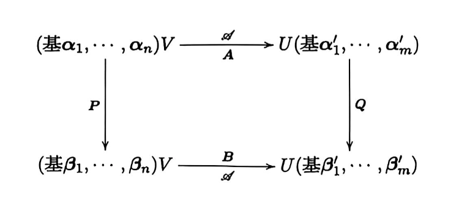
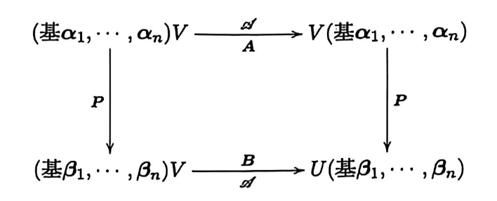

# 第二章 线性映射

## 2.1 线性映射
### 线性映射的概念

- **线性映射**：设 $V$ 和 $U$ 为数域 $\mathbb{F}$ 上的线性空间。若映射 $\mathcal{A}:V\to U$ 满足

    1. **保持加法**：$\mathcal{A}(\boldsymbol{\alpha}+\boldsymbol{\beta})=\mathcal{A}(\boldsymbol{\alpha})+\mathcal{A}(\boldsymbol{\beta}),\quad\forall\boldsymbol{\alpha},\boldsymbol{\beta}\in V$；

    2. **保持纯量乘法**：$\mathcal{A}(k\boldsymbol{\alpha})=k\mathcal{A}(\boldsymbol{\alpha}),\quad\forall k\in\mathbb{F},\boldsymbol{\alpha}\in V$；

    则称 $\mathcal{A}$ 为 $V$ 到 $U$ 的线性映射。

- **像与原像**：设 $\mathcal{A}:V\to U$ 为线性映射，$\boldsymbol{\alpha}\in V$，则 $\mathcal{A}(\boldsymbol{\alpha})\in U$ 称为 $\boldsymbol{\alpha}$ 的像，$\boldsymbol{\alpha}$ 称为 $\mathcal{A}(\boldsymbol{\alpha})$ 的原像。

- **数乘映射**：设 $k\in\mathbb{F}$ 为固定常数，定义 $\mathcal{A}:V\to V$ 为

    $$
    \mathcal{A}(\boldsymbol{\alpha})=k\boldsymbol{\alpha},\quad\forall\boldsymbol{\alpha}\in V
    $$

    则 $\mathcal{A}$ 为线性映射，称为数乘映射。

    - **恒等映射**：$k=1$ 时，称为恒等映射，记为 $\mathcal{I}_V$ 或 $\mathcal{I}$。

    - **零映射**：$k=0$ 时，称为零映射，记为 $\mathcal{O}$，即 $\mathcal{O}(\boldsymbol{\alpha})=\boldsymbol{0}$。

- **线性映射的集合**：记 $\operatorname{Hom}_{\mathbb{F}}(V,U)$ 为 $V$ 到 $U$ 的所有线性映射组成的集合，即

    $$
    \operatorname{Hom}_{\mathbb{F}}(V,U)=\{\mathcal{A}\mid\mathcal{A}:V\to U\text{ 为线性映射}\}
    $$

    则 $\operatorname{Hom}_{\mathbb{F}}(V,U)$ 是数域 $\mathbb{F}$ 上的线性空间。

    $$
    \operatorname{End}_{\mathbb{F}}(V)=\operatorname{Hom}_{\mathbb{F}}(V,V)
    $$

    为 $V$ 到自身的所有线性映射组成的集合。

    $$
    V^*=\operatorname{Hom}_{\mathbb{F}}(V,\mathbb{F})
    $$

    为 $V$ 到数域 $\mathbb{F}$ 的所有线性映射组成的集合，即 $V$ 的对偶空间。

### 线性映射的性质

- **零向量与负向量的像**：设 $\mathcal{A}:V\to U$ 为线性映射，则

    $$
    \mathcal{A}(\boldsymbol{0})=\boldsymbol{0},\qquad\mathcal{A}(-\boldsymbol{\alpha})=-\mathcal{A}(\boldsymbol{\alpha}),\quad\forall\boldsymbol{\alpha}\in V
    $$

- **保持线性组合**：设 $\mathcal{A}:V\to U$ 为线性映射，则对任意 $\boldsymbol{\alpha}_1,\dots,\boldsymbol{\alpha}_s\in V$ 和 $k_1,\dots,k_s\in\mathbb{F}$，有

    $$
    \mathcal{A}\left(\sum_{i=1}^s k_i\boldsymbol{\alpha}_i\right)=\sum_{i=1}^s k_i\mathcal{A}(\boldsymbol{\alpha}_i)
    $$

- **线性相关性的保持**：设 $\mathcal{A}:V\to U$ 为线性映射，则

    1. 若 $\boldsymbol{\alpha}_1,\dots,\boldsymbol{\alpha}_s$ 线性相关，则 $\mathcal{A}(\boldsymbol{\alpha}_1),\dots,\mathcal{A}(\boldsymbol{\alpha}_s)$ 线性相关；

    2. 若 $\mathcal{A}(\boldsymbol{\alpha}_1),\dots,\mathcal{A}(\boldsymbol{\alpha}_s)$ 线性无关，则 $\boldsymbol{\alpha}_1,\dots,\boldsymbol{\alpha}_s$ 线性无关。

## 2.2 线性映射与矩阵
### 线性映射在给定基下的矩阵

- **线性映射的矩阵表示**：设 $V$ 和 $U$ 分别为数域 $\mathbb{F}$ 上的 $n$ 维和 $m$ 维线性空间，$\mathcal{A}:V\to U$ 为线性映射。设 $\boldsymbol{\alpha}_1,\dots,\boldsymbol{\alpha}_n$ 为 $V$ 的一组基，$\boldsymbol{\beta}_1,\dots,\boldsymbol{\beta}_m$ 为 $U$ 的一组基，且

    $$
    \mathcal{A}(\boldsymbol{\alpha}_j)=\sum_{i=1}^m a_{ij}\boldsymbol{\beta}_i,\quad j=1,\dots,n
    $$

    则称 $\mathbf{A}=(a_{ij})_{m\times n}$ 为 $\mathcal{A}$ 在这两组基下的矩阵，即

    $$
    (\mathcal{A}(\boldsymbol{\alpha}_1),\dots,\mathcal{A}(\boldsymbol{\alpha}_n))=(\boldsymbol{\beta}_1,\dots,\boldsymbol{\beta}_m)\mathbf{A}
    $$

    其中 $\mathbf{A}$ 的第 $j$ 列为 $\mathcal{A}(\boldsymbol{\alpha}_j)$ 在 $U$ 的给定基下的坐标。

    - **唯一性**：固定 $V$ 和 $U$ 的上述两组基，对任意 $\mathbf{A}\in\mathbb{F}^{m\times n}$，存在唯一的线性映射 $\mathcal{A}:V\to U$，使其在这两组基下的矩阵为 $\mathbf{A}$。

- **像的坐标公式**：若 $\mathcal{A}$ 在上述两组基下的矩阵为 $\mathbf{A}$，且 $\boldsymbol{\alpha}\in V$ 在基 $\boldsymbol{\alpha}_1,\dots,\boldsymbol{\alpha}_n$ 下的坐标为 $\boldsymbol{x}$，则 $\mathcal{A}(\boldsymbol{\alpha})$ 在基 $\boldsymbol{\beta}_1,\dots,\boldsymbol{\beta}_m$ 下的坐标为

    $$
    \boldsymbol{y}=\mathbf{A}\boldsymbol{x}
    $$

- **线性映射与矩阵的一一对应**：记 $\operatorname{Hom}_{\mathbb{F}}(V,U)$ 为 $V$ 到 $U$ 的所有线性映射组成的集合。固定 $V$ 和 $U$ 的基后，$\operatorname{Hom}_{\mathbb{F}}(V,U)$ 与 $\mathbb{F}^{m\times n}$ 中的矩阵一一对应。

### 线性映射的值域与核

- **值域与核**：设 $\mathcal{A}:V\to U$ 为线性映射，定义

    - **值域（像空间）**：

        $$
        \operatorname{Im}(\mathcal{A})=\{\mathcal{A}(\boldsymbol{\alpha})\mid\boldsymbol{\alpha}\in V\}=\mathcal{A}(V)
        $$

    - **核（核空间）**：

        $$
        \operatorname{Ker}(\mathcal{A})=\{\boldsymbol{\alpha}\in V\mid\mathcal{A}(\boldsymbol{\alpha})=\boldsymbol{0}\}
        $$

    - **性质**：

        - $\operatorname{Im}(\mathcal{A})$ 是 $U$ 的子空间

        - $\operatorname{Ker}(\mathcal{A})$ 是 $V$ 的子空间

- **秩与零度**：设 $\mathcal{A}:V\to U$ 为有限维线性空间之间的线性映射。

    - **秩**：$r(\mathcal{A})=\dim\operatorname{Im}(\mathcal{A})$

    - **零度**：$r(\operatorname{Ker}(\mathcal{A}))=\dim\operatorname{Ker}(\mathcal{A})$

- **秩与零度定理**：设 $V$ 为有限维线性空间，$\mathcal{A}:V\to U$ 为线性映射，则

    $$
    \dim\operatorname{Im}(\mathcal{A})+\dim\operatorname{Ker}(\mathcal{A})=\dim V
    $$

- **像空间与矩阵列空间的关系**：设 $V$ 和 $U$ 分别为数域 $\mathbb{F}$ 上的 $n$ 维和 $m$ 维线性空间，$\mathcal{A}:V\to U$ 为线性映射，在基 $\boldsymbol{\alpha}_1,\dots,\boldsymbol{\alpha}_n$ 和 $\boldsymbol{\beta}_1,\dots,\boldsymbol{\beta}_m$ 下的矩阵为 $\mathbf{A}$，则

    $$
    \begin{aligned}
    \operatorname{Im}(\mathcal{A})&=L(\mathcal{A}(\boldsymbol{\alpha}_1),\dots,\mathcal{A}(\boldsymbol{\alpha}_n))\\
    &=\{(\boldsymbol{\beta}_1,\dots,\boldsymbol{\beta}_m)\boldsymbol{y}\mid\boldsymbol{y}\in R(\mathbf{A})\}
    \end{aligned}
    $$

    - **秩的关系**：$r(\mathcal{A})=\operatorname{rank}(\mathbf{A})$。

    - **值域的基**：若 $\boldsymbol{\xi}_1,\dots,\boldsymbol{\xi}_r$ 为 $R(\mathbf{A})$ 的一组基，则

        $$
        (\boldsymbol{\beta}_1,\dots,\boldsymbol{\beta}_m)\boldsymbol{\xi}_1,\quad\dots,\quad(\boldsymbol{\beta}_1,\dots,\boldsymbol{\beta}_m)\boldsymbol{\xi}_r
        $$

        为 $\operatorname{Im}(\mathcal{A})$ 的一组基。

- **核空间与矩阵零空间的关系**：在上述条件下，有

    $$
    \operatorname{Ker}(\mathcal{A})=\{(\boldsymbol{\alpha}_1,\dots,\boldsymbol{\alpha}_n)\boldsymbol{x}\mid\boldsymbol{x}\in N(\mathbf{A})\}
    $$

    - **零度的计算**：$\dim\operatorname{Ker}(\mathcal{A})=n-\operatorname{rank}(\mathbf{A})$。

    - **核的基**：若 $\boldsymbol{\eta}_1,\dots,\boldsymbol{\eta}_{n-r}$ 为 $N(\mathbf{A})$ 的一组基，则

        $$
        (\boldsymbol{\alpha}_1,\dots,\boldsymbol{\alpha}_n)\boldsymbol{\eta}_1,\dots,(\boldsymbol{\alpha}_1,\dots,\boldsymbol{\alpha}_n)\boldsymbol{\eta}_{n-r}
        $$

        为 $\operatorname{Ker}(\mathcal{A})$ 的一组基。

- **像空间基的原像与核的基**：设 $V$ 为 $n$ 维线性空间，$\mathcal{A}:V\to V$ 为线性映射。若 $\boldsymbol{\beta}_1,\dots,\boldsymbol{\beta}_r$ 为 $\operatorname{Im}(\mathcal{A})$ 的一组基，对每个 $i=1,\dots,r$ 选取一个原像 $\boldsymbol{\alpha}_i$，使得 $\mathcal{A}(\boldsymbol{\alpha}_i)=\boldsymbol{\beta}_i$，再取 $\operatorname{Ker}(\mathcal{A})$ 的一组基 $\boldsymbol{\alpha}_{r+1},\dots,\boldsymbol{\alpha}_n$，则 $\boldsymbol{\alpha}_1,\dots,\boldsymbol{\alpha}_n$ 构成 $V$ 的一组基。

### 线性映射与等价矩阵

- **不同基下矩阵的等价关系**：设 $V$ 和 $U$ 分别为数域 $\mathbb{F}$ 上的 $n$ 维和 $m$ 维线性空间，$\mathcal{A}:V\to U$ 为线性映射，设满足：

    1. $\mathcal{A}$ 在 $V$ 的基 $\boldsymbol{\alpha}_1,\dots,\boldsymbol{\alpha}_n$ 和 $U$ 的基 $\boldsymbol{\alpha}'_1,\dots,\boldsymbol{\alpha}'_m$ 下的矩阵为 $\mathbf{A}$，即

        $$
        \mathcal{A}(\boldsymbol{\alpha}_1,\dots,\boldsymbol{\alpha}_n)=(\boldsymbol{\alpha}'_1,\dots,\boldsymbol{\alpha}'_m)\mathbf{A}
        $$

    2. $\mathcal{A}$ 在 $V$ 的基 $\boldsymbol{\beta}_1,\dots,\boldsymbol{\beta}_n$ 和 $U$ 的基 $\boldsymbol{\beta}'_1,\dots,\boldsymbol{\beta}'_m$ 下的矩阵为 $\mathbf{B}$，即

        $$
        \mathcal{A}(\boldsymbol{\beta}_1,\dots,\boldsymbol{\beta}_n)=(\boldsymbol{\beta}'_1,\dots,\boldsymbol{\beta}'_m)\mathbf{B}
        $$

    3. 从 $\boldsymbol{\alpha}_1,\dots,\boldsymbol{\alpha}_n$ 到 $\boldsymbol{\beta}_1,\dots,\boldsymbol{\beta}_n$ 的过渡矩阵为 $\mathbf{P}$，即

        $$
        (\boldsymbol{\beta}_1,\dots,\boldsymbol{\beta}_n)=(\boldsymbol{\alpha}_1,\dots,\boldsymbol{\alpha}_n)\mathbf{P}
        $$

    4. 从 $\boldsymbol{\alpha}'_1,\dots,\boldsymbol{\alpha}'_m$ 到 $\boldsymbol{\beta}'_1,\dots,\boldsymbol{\beta}'_m$ 的过渡矩阵为 $\mathbf{Q}$，即

        $$
        (\boldsymbol{\beta}'_1,\dots,\boldsymbol{\beta}'_m)=(\boldsymbol{\alpha}'_1,\dots,\boldsymbol{\alpha}'_m)\mathbf{Q}
        $$

    则 $\mathbf{A}$ 与 $\mathbf{B}$ 等价，且

    $$
    \mathbf{B}=\mathbf{Q}^{-1}\mathbf{A}\mathbf{P}
    $$

    即 

- **线性映射的相抵标准形**：设 $\dim V=n$，$\dim U=m$，$\mathcal{A}:V\to U$ 为线性映射，$r=r(\mathcal{A})$。则存在 $V$ 的一组基 $\boldsymbol{\alpha}_1,\dots,\boldsymbol{\alpha}_n$ 和 $U$ 的一组基 $\boldsymbol{\beta}_1,\dots,\boldsymbol{\beta}_m$，使得 $\mathcal{A}$ 在这两组基下的矩阵为

    $$
    \begin{pmatrix}
    \mathbf{I}_r & \mathbf{0}\\
    \mathbf{0} & \mathbf{0}
    \end{pmatrix}_{m\times n}
    $$

    此时 $\boldsymbol{\beta}_1,\dots,\boldsymbol{\beta}_r$ 为 $\operatorname{Im}(\mathcal{A})$ 的一组基，$\boldsymbol{\alpha}_{r+1},\dots,\boldsymbol{\alpha}_n$ 为 $\operatorname{Ker}(\mathcal{A})$ 的一组基。

### 线性映射与相似矩阵

- **线性空间到自身的线性映射**：记 $\operatorname{End}_{\mathbb{F}}(V)$ 为 $V$ 到自身的所有线性映射组成的集合，则

    $$
    \operatorname{End}_{\mathbb{F}}(V)=\operatorname{Hom}_{\mathbb{F}}(V,V)
    $$

    对 $\mathcal{A}\in\operatorname{End}_{\mathbb{F}}(V)$，在定义域和陪域取相同的基 $\boldsymbol{\alpha}_1,\dots,\boldsymbol{\alpha}_n$，若

    $$
    (\mathcal{A}(\boldsymbol{\alpha}_1),\dots,\mathcal{A}(\boldsymbol{\alpha}_n))=(\boldsymbol{\alpha}_1,\dots,\boldsymbol{\alpha}_n)\mathbf{A}
    $$

    则称 $\mathbf{A}$ 为 $\mathcal{A}$ 在该基下的矩阵。

- **不同基下矩阵的相似关系**：设 $V$ 是数域 $\mathbb{F}$ 上的 $n$ 维线性空间，$\mathcal{A}:V\to V$ 为线性映射，设满足：

    1. $\mathcal{A}$ 在基 $\boldsymbol{\alpha}_1,\dots,\boldsymbol{\alpha}_n$ 下的矩阵为 $\mathbf{A}$，即

        $$
        \mathcal{A}(\boldsymbol{\alpha}_1,\dots,\boldsymbol{\alpha}_n)=(\boldsymbol{\alpha}_1,\dots,\boldsymbol{\alpha}_n)\mathbf{A}
        $$

    2. $\mathcal{A}$ 在基 $\boldsymbol{\beta}_1,\dots,\boldsymbol{\beta}_n$ 下的矩阵为 $\mathbf{B}$，即

        $$
        \mathcal{A}(\boldsymbol{\beta}_1,\dots,\boldsymbol{\beta}_n)=(\boldsymbol{\beta}_1,\dots,\boldsymbol{\beta}_n)\mathbf{B}
        $$

    3. 从 $\boldsymbol{\alpha}_1,\dots,\boldsymbol{\alpha}_n$ 到 $\boldsymbol{\beta}_1,\dots,\boldsymbol{\beta}_n$ 的过渡矩阵为 $\mathbf{P}$，即

        $$
        (\boldsymbol{\beta}_1,\dots,\boldsymbol{\beta}_n)=(\boldsymbol{\alpha}_1,\dots,\boldsymbol{\alpha}_n)\mathbf{P}
        $$

    则 $\mathbf{A}$ 与 $\mathbf{B}$ 相似，且

    $$
    \mathbf{B}=\mathbf{P}^{-1}\mathbf{A}\mathbf{P}
    $$

    即 

- **线性映射的特征值与特征向量**：设 $\mathcal{A}\in\operatorname{End}_{\mathbb{F}}(V)$，$\lambda\in\mathbb{F}$。若存在非零向量 $\boldsymbol{\alpha}\in V$，使得

    $$
    \mathcal{A}(\boldsymbol{\alpha})=\lambda\boldsymbol{\alpha}
    $$

    则称 $\lambda$ 为 $\mathcal{A}$ 的一个特征值，$\boldsymbol{\alpha}$ 为 $\mathcal{A}$ 的属于特征值 $\lambda$ 的特征向量。

- **特征子空间**：设 $\lambda$ 为 $\mathcal{A}$ 的特征值，称

    $$
    E(\lambda,\mathcal{A})=\{\boldsymbol{\alpha}\in V\mid\mathcal{A}(\boldsymbol{\alpha})=\lambda\boldsymbol{\alpha}\}
    $$

    为 $\mathcal{A}$ 的属于特征值 $\lambda$ 的特征子空间。

- **线性映射的行列式与迹**：设 $V$ 为有限维线性空间，$\mathcal{A}\in\operatorname{End}_{\mathbb{F}}(V)$，$\mathbf{A}$ 为 $\mathcal{A}$ 在任意一组基下的矩阵，定义

    $$
    \det(\mathcal{A})=\det(\mathbf{A}),\qquad\operatorname{tr}(\mathcal{A})=\operatorname{tr}(\mathbf{A})
    $$

    它们均与基的选取无关。

- **线性映射与矩阵的特征值关系**：设 $V$ 为 $n$ 维线性空间，$\mathcal{A}$ 在基 $\boldsymbol{\alpha}_1,\dots,\boldsymbol{\alpha}_n$ 下的矩阵为 $\mathbf{A}$，则

    1. $\lambda\in\mathbb{F}$ 为 $\mathcal{A}$ 的特征值 $\iff \lambda$ 为 $\mathbf{A}$ 的特征值；

    2. 若 $\boldsymbol{\alpha}$ 在该基下的坐标为 $\boldsymbol{x}$，则：$\boldsymbol{\alpha}$ 为 $\mathcal{A}$ 的属于特征值 $\lambda$ 的特征向量 $\iff \boldsymbol{x}$ 为 $\mathbf{A}$ 的属于特征值 $\lambda$ 的特征向量；

    3. 特征子空间可表示为

        $$
        \begin{aligned}
        E(\lambda,\mathcal{A})&=\{\boldsymbol{\alpha}\in V\mid\mathcal{A}(\boldsymbol{\alpha})=\lambda\boldsymbol{\alpha}\}\\
        &=\{(\boldsymbol{\alpha}_1,\dots,\boldsymbol{\alpha}_n)\boldsymbol{x}\mid(\mathbf{A}-\lambda\mathbf{I})\boldsymbol{x}=\boldsymbol{0}\}
        \end{aligned}
        $$

## 2.3 线性映射的运算
### 同构映射和线性空间的分类

- **单射、满射与同构映射**：设 $V$ 和 $U$ 为数域 $\mathbb{F}$ 上的线性空间，$\mathcal{A}:V\to U$ 为线性映射。

    - **单射**：$\mathcal{A}(\boldsymbol{\alpha})=\mathcal{A}(\boldsymbol{\beta}) \implies \boldsymbol{\alpha}=\boldsymbol{\beta}$

    - **满射**：$\forall \boldsymbol{u}\in U$，$\exists \boldsymbol{\alpha}\in V$，$s.t. ~\mathcal{A}(\boldsymbol{\alpha})=\boldsymbol{u}$

    - **双射（同构映射）**：若 $\mathcal{A}$ 既是单射又是满射，则称其为同构映射，称 $V$ 与 $U$ 同构，记为 $V\cong U$。

- **定理**：

    - **单射与满射的判定**：设 $\dim V=n$，$\dim U=m$，$\mathcal{A}:V\to U$ 为线性映射，则

        1. $\mathcal{A}$ 为单射 $\iff\operatorname{Ker}(\mathcal{A})=\{\boldsymbol{0}\}\iff r(\mathcal{A})=n$；

        2. $\mathcal{A}$ 为满射 $\iff\operatorname{Im}(\mathcal{A})=U\iff r(\mathcal{A})=m$。

    - **单射与满射的维数限制**：设 $V$ 和 $U$ 为有限维线性空间，$\mathcal{A}:V\to U$ 为线性映射，则

        1. 若 $\mathcal{A}$ 为单射，则 $\dim V\leq\dim U$；

        2. 若 $\mathcal{A}$ 为满射，则 $\dim V\geq\dim U$。

    - **同构充要条件**：同一数域 $\mathbb{F}$ 上的两个有限维线性空间 $V$ 与 $U$ 同构，当且仅当

        $$
        \dim V=\dim U
        $$

- **同构映射的性质**：设 $\mathcal{A}:V\to U$ 为同构映射，则

    1. $\boldsymbol{\alpha}_1,\dots,\boldsymbol{\alpha}_s$ 线性相关（无关），当且仅当 $\mathcal{A}(\boldsymbol{\alpha}_1),\dots,\mathcal{A}(\boldsymbol{\alpha}_s)$ 线性相关（无关）；

    2. 若 $\boldsymbol{\alpha}_1,\dots,\boldsymbol{\alpha}_s$ 线性无关，且 $\boldsymbol{\alpha}=\sum_{i=1}^s x_i\boldsymbol{\alpha}_i$，则

        $$
        \mathcal{A}(\boldsymbol{\alpha})=\sum_{i=1}^s x_i\mathcal{A}(\boldsymbol{\alpha}_i)
        $$

        且此线性表示的系数唯一；

    3. 若 $W$ 为 $V$ 的子空间，$\boldsymbol{\alpha}_1,\dots,\boldsymbol{\alpha}_r$ 为 $W$ 的一组基，则 $\mathcal{A}(W)$ 为 $U$ 的子空间，$\mathcal{A}(\boldsymbol{\alpha}_1),\dots,\mathcal{A}(\boldsymbol{\alpha}_r)$ 为 $\mathcal{A}(W)$ 的一组基，特别地，

        $$
        \dim\mathcal{A}(W)=\dim W
        $$

- **坐标同构**：设 $V$ 为数域 $\mathbb{F}$ 上的 $n$ 维线性空间，$\boldsymbol{\varepsilon}_1,\dots,\boldsymbol{\varepsilon}_n$ 为 $V$ 的一组基。对任意 $\boldsymbol{\alpha}\in V$，设

    $$
    \boldsymbol{\alpha}=(\boldsymbol{\varepsilon}_1,\dots,\boldsymbol{\varepsilon}_n)\boldsymbol{x}_{\boldsymbol{\alpha}}
    $$

    则坐标映射

    $$
    \begin{aligned}
    \mathcal{C}:V&\to\mathbb{F}^n\\
    \boldsymbol{\alpha}&\mapsto\boldsymbol{x}_{\boldsymbol{\alpha}}
    \end{aligned}
    $$

    为同构映射。因此 $V\cong\mathbb{F}^n$。

    - **推论**：在上述坐标同构下，有

        1. $\boldsymbol{\alpha}_1,\dots,\boldsymbol{\alpha}_s$ 线性相关（无关），当且仅当 $\boldsymbol{x}_{\boldsymbol{\alpha}_1},\dots,\boldsymbol{x}_{\boldsymbol{\alpha}_s}$ 线性相关（无关）；

        2. $\boldsymbol{\alpha}_1,\dots,\boldsymbol{\alpha}_n$ 为 $V$ 的一组基，当且仅当 $\boldsymbol{x}_{\boldsymbol{\alpha}_1},\dots,\boldsymbol{x}_{\boldsymbol{\alpha}_n}$ 为 $\mathbb{F}^n$ 的一组基，即

            $$
            \det(\boldsymbol{x}_{\boldsymbol{\alpha}_1},\dots,\boldsymbol{x}_{\boldsymbol{\alpha}_n})\ne0
            $$

        3. 令 $W=L(\boldsymbol{\alpha}_1,\dots,\boldsymbol{\alpha}_s)$，则

            $$
            \mathcal{C}(W)=L(\boldsymbol{x}_{\boldsymbol{\alpha}_1},\dots,\boldsymbol{x}_{\boldsymbol{\alpha}_s})
            $$

            当且仅当 $\boldsymbol{x}_{\boldsymbol{\alpha}_1},\dots,\boldsymbol{x}_{\boldsymbol{\alpha}_s}$ 为 $\mathcal{C}(W)$ 的一组基时 $\boldsymbol{\alpha}_1,\dots,\boldsymbol{\alpha}_s$ 为 $W$ 的基，故

            $$
            \dim\mathcal{C}(W)=\dim W
            $$

- **线性空间的同构分类**：同一数域上的线性空间之间的同构关系具有自反性、对称性和传递性。有限维线性空间按维数分类，每个 $n$ 维线性空间均与 $\mathbb{F}^n$ 同构。

- **像空间与核空间的坐标同构**：设 $\mathcal{A}:V\to U$ 为有限维线性空间之间的线性映射，其在给定基下的矩阵为 $\mathbf{A}$，则对应的坐标映射给出

    $$
    \operatorname{Im}(\mathcal{A})\cong R(\mathbf{A}),\qquad
    \operatorname{Ker}(\mathcal{A})\cong N(\mathbf{A})
    $$

- **内积空间的同构**：设 $V$ 和 $U$ 为同一数域 $\mathbb{F}$ 上的有限维内积空间。若存在同构映射 $\mathcal{A}:V\to U$，且满足

    $$
    (\mathcal{A}(\boldsymbol{\alpha}),\mathcal{A}(\boldsymbol{\beta}))=(\boldsymbol{\alpha},\boldsymbol{\beta}),\quad\forall\boldsymbol{\alpha},\boldsymbol{\beta}\in V
    $$

    则称内积空间 $V$ 与 $U$ 同构。

    - **充要条件**：同一数域上的两个有限维内积空间同构，当且仅当它们的维数相同。

### 线性映射的加法和纯量乘法

- **线性映射的和与纯量乘积**：设 $\mathcal{A},\mathcal{B}\in\operatorname{Hom}_{\mathbb{F}}(V,U)$，$k\in\mathbb{F}$，定义两个线性映射的和 $\mathcal{A}+\mathcal{B}$ 与纯量乘积 $k\mathcal{A}$：

    - **和**：

        $$
        (\mathcal{A}+\mathcal{B})(\boldsymbol{\alpha})=\mathcal{A}(\boldsymbol{\alpha})+\mathcal{B}(\boldsymbol{\alpha}),\quad\forall\boldsymbol{\alpha}\in V
        $$

    - **纯量乘积**：

        $$
        (k\mathcal{A})(\boldsymbol{\alpha})=k\mathcal{A}(\boldsymbol{\alpha}),\quad\forall\boldsymbol{\alpha}\in V
        $$

    二者均为 $V$ 到 $U$ 的线性映射。

- **矩阵表示**：固定 $V$ 和 $U$ 的基，设 $\mathcal{A}$ 与 $\mathcal{B}$ 在这两组基下的矩阵分别为 $\mathbf{A}$ 与 $\mathbf{B}$，则

    1. $\mathcal{A}+\mathcal{B}$ 在这两组基下的矩阵为 $\mathbf{A}+\mathbf{B}$；

    2. $k\mathcal{A}$ 在这两组基下的矩阵为 $k\mathbf{A}$。

- **线性映射空间的结构与维数**：设 $\dim V=n$，$\dim U=m$，则 $\operatorname{Hom}_{\mathbb{F}}(V,U)$ 关于上述加法和纯量乘法构成数域 $\mathbb{F}$ 上的线性空间，且固定基后的矩阵表示给出同构

    $$
    \operatorname{Hom}_{\mathbb{F}}(V,U)\cong\mathbb{F}^{m\times n}
    $$

    因而

    $$
    \dim\operatorname{Hom}_{\mathbb{F}}(V,U)=mn
    $$

### 线性映射的积

- **线性映射的积（复合）**：设 $\mathcal{B}:V\to U$ 和 $\mathcal{A}:U\to W$ 为线性映射，定义两个线性映射的积（复合） $\mathcal{A}\mathcal{B}=\mathcal{A}\circ\mathcal{B}$：

    $$
    (\mathcal{A}\mathcal{B})(\boldsymbol{\alpha})=\mathcal{A}(\mathcal{B}(\boldsymbol{\alpha})),\quad\forall\boldsymbol{\alpha}\in V
    $$

    它是 $V$ 到 $W$ 的线性映射，作用顺序为先 $\mathcal{B}$、后 $\mathcal{A}$。

- **矩阵表示**：设 $\dim V=n$，$\dim U=m$，$\dim W=s$，固定这三个空间的基。若 $\mathcal{B}:V\to U$ 的矩阵为 $\mathbf{B}\in\mathbb{F}^{m\times n}$，$\mathcal{A}:U\to W$ 的矩阵为 $\mathbf{A}\in\mathbb{F}^{s\times m}$，则 $\mathcal{A}\mathcal{B}:V\to W$ 的矩阵为

    $$
    \mathbf{A}\mathbf{B}\in\mathbb{F}^{s\times n}
    $$

- **说明**：对 $\mathcal{A},\mathcal{B}\in\operatorname{End}_{\mathbb{F}}(V)$，一般不满足交换律，即一般有 $\mathcal{A}\mathcal{B}\ne\mathcal{B}\mathcal{A}$。

### 线性映射的幂

- **线性映射的幂**：设 $\mathcal{A}\in\operatorname{End}_{\mathbb{F}}(V)$，定义 $\mathcal{A}$ 的 $k$ 次幂 $\mathcal{A}^k$ 为

    $$
    \mathcal{A}^0=\mathcal{I}_V,\qquad\mathcal{A}^1=\mathcal{A},\qquad
    \mathcal{A}^k=\mathcal{A}^{k-1}\mathcal{A},\quad k\geq2
    $$

    它是 $V$ 到自身的线性映射。

- **线性映射的多项式**：设 $\mathcal{A}\in\operatorname{End}_{\mathbb{F}}(V)$，$f(x)=a_mx^m+\dots+a_1x+a_0\in\mathbb{F}[x]$，定义

    $$
    f(\mathcal{A})=a_m\mathcal{A}^m+\dots+a_1\mathcal{A}+a_0\mathcal{I}_V
    $$

    称为由 $f(x)$ 确定的 $\mathcal{A}$ 的多项式。

- **矩阵表示**：设 $\mathcal{A}$ 在 $V$ 的某组基下的矩阵为 $\mathbf{A}$，则 $\mathcal{A}^k$ 和 $f(\mathcal{A})$ 在同一组基下的矩阵分别为 $\mathbf{A}^k$ 和 $f(\mathbf{A})$。

- **同一线性映射的多项式可交换**：设 $\mathcal{A}\in\operatorname{End}_{\mathbb{F}}(V)$，$f(x),g(x)\in\mathbb{F}[x]$，则

    $$
    f(\mathcal{A})g(\mathcal{A})=g(\mathcal{A})f(\mathcal{A})
    $$

