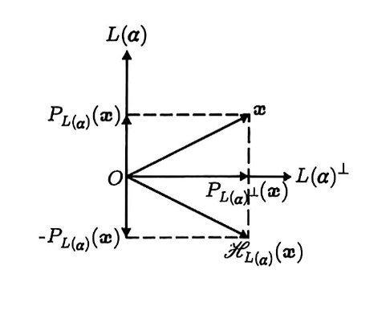

# 第三章 从矩阵到线性映射

## 3.1 常见矩阵与线性映射
### 可逆矩阵与可逆映射

- **可逆映射与逆映射**：设 $\mathcal{A}\in\operatorname{Hom}_{\mathbb{F}}(V,U)$。若存在 $\mathcal{B}\in\operatorname{Hom}_{\mathbb{F}}(U,V)$，使得

    $$
    \mathcal{B}\mathcal{A}=\mathcal{I}_V,\qquad\mathcal{A}\mathcal{B}=\mathcal{I}_U
    $$

    则称 $\mathcal{A}$ 为可逆映射，$\mathcal{B}$ 为 $\mathcal{A}$ 的逆映射，记为 $\mathcal{A}^{-1}$。

- **可逆映射的矩阵判定**：设 $V$ 和 $U$ 为数域 $\mathbb{F}$ 上的有限维线性空间，$\mathcal{A}:V\to U$ 在给定两组基下的矩阵为 $\mathbf{A}$，则 $\mathcal{A}$ 可逆当且仅当 $\mathbf{A}$ 可逆。此时

    1. $\dim V=\dim U$；

    2. $\mathcal{A}^{-1}$ 唯一；

    3. $\mathcal{A}^{-1}$ 在交换定义域与陪域的上述两组基下的矩阵为 $\mathbf{A}^{-1}$。

- **可逆映射与同构映射**：设 $V$ 和 $U$ 为数域 $\mathbb{F}$ 上的 $n$ 维线性空间，$\mathcal{A}:V\to U$ 为线性映射，则 $\mathcal{A}$ 可逆 $\iff \mathcal{A}$ 为同构映射。

    - 特别地，若 $U=V$，则下列陈述等价：

        1. $\mathcal{A}$ 为单射

        2. $\mathcal{A}$ 为满射

        3. $\mathcal{A}$ 可逆

### 幂零矩阵与幂零映射

- **幂零矩阵与幂零指数**：设 $\mathbf{A}\in\mathbb{F}^{n\times n}$。若存在正整数 $k$，使得 $\mathbf{A}^k=\mathbf{0}$，则称 $\mathbf{A}$ 为幂零矩阵。使该式成立的最小正整数 $k$ 称为 $\mathbf{A}$ 的幂零指数。

- **幂零映射与幂零指数**：设 $V$ 为数域 $\mathbb{F}$ 上的 $n$ 维线性空间，$\mathcal{A}\in\operatorname{End}_{\mathbb{F}}(V)$。若存在正整数 $k$，使得

    $$
    \mathcal{A}^k=\mathcal{O}
    $$

    则称 $\mathcal{A}$ 为幂零映射。使该式成立的最小正整数 $k$ 称为 $\mathcal{A}$ 的幂零指数。

- **幂零映射的矩阵判定**：设 $V$ 为数域 $\mathbb{F}$ 上的 $n$ 维线性空间，$\mathbf{A}$ 为 $\mathcal{A}\in\operatorname{End}_{\mathbb{F}}(V)$ 在一组基下的矩阵，则 $\mathcal{A}$ 为幂零映射当且仅当 $\mathbf{A}$ 为幂零矩阵，即

    $$
    \mathcal{A}^k=\mathcal{O}\iff\mathbf{A}^k=\mathbf{0}
    $$

    且二者的幂零指数相同。

### 幂等矩阵、幂等映射与投影映射

- **幂等映射**：设 $V$ 为数域 $\mathbb{F}$ 上的 $n$ 维线性空间，$\mathcal{A}\in\operatorname{End}_{\mathbb{F}}(V)$。若 $\mathcal{A}$ 满足

    $$
    \mathcal{A}^2=\mathcal{A}
    $$

    则称 $\mathcal{A}$ 为幂等映射。

- **幂等映射的矩阵判定**：设 $V$ 为数域 $\mathbb{F}$ 上的 $n$ 维线性空间，$\mathbf{A}$ 为 $\mathcal{A}\in\operatorname{End}_{\mathbb{F}}(V)$ 在一组基下的矩阵，则 $\mathcal{A}$ 为幂等映射当且仅当 $\mathbf{A}$ 为幂等矩阵，即

    $$
    \mathcal{A}^2=\mathcal{A}\iff\mathbf{A}^2=\mathbf{A}
    $$

- **幂等映射的直和分解**：设 $V$ 为数域 $\mathbb{F}$ 上的 $n$ 维线性空间，$\mathcal{A}$ 为 $V$ 上的幂等映射，则

    $$
    V=\operatorname{Ker}(\mathcal{A})\oplus\operatorname{Im}(\mathcal{A})
    $$

    - 对任意 $\boldsymbol{\alpha}\in V$，其可分解为

        $$
        \boldsymbol{\alpha}=\bigl(\boldsymbol{\alpha}-\mathcal{A}(\boldsymbol{\alpha})\bigr)+\mathcal{A}(\boldsymbol{\alpha})
        $$

        其中 $\boldsymbol{\alpha}-\mathcal{A}(\boldsymbol{\alpha})\in\operatorname{Ker}(\mathcal{A})$，$\mathcal{A}(\boldsymbol{\alpha})\in\operatorname{Im}(\mathcal{A})$。

- **投影映射的线性性**：设 $V=U\oplus W$。对任意 $\boldsymbol{\alpha}=\boldsymbol{u}+\boldsymbol{w}$，其中 $\boldsymbol{u}\in U$、$\boldsymbol{w}\in W$，定义

    $$
    P_{U,W}(\boldsymbol{\alpha})=\boldsymbol{u}
    $$

    则 $P_{U,W}$ 是 $V$ 到自身的一个线性映射，称为沿子空间 $W$ 在子空间 $U$ 上的投影映射。

- **幂等映射与投影映射的等价性**：设 $V$ 为数域 $\mathbb{F}$ 上的 $n$ 维线性空间，$\mathcal{A}\in\operatorname{End}_{\mathbb{F}}(V)$，则下列陈述等价：

    1. $\mathcal{A}$ 为幂等映射

    2. $\mathcal{A}$ 为投影映射

    3. $\mathcal{A}$ 是沿 $\operatorname{Ker}(\mathcal{A})$ 在 $\operatorname{Im}(\mathcal{A})$ 上的投影映射

    4. $\mathcal{A}$ 在一组基下的矩阵 $\mathbf{A}$ 满足 $\mathbf{A}^2=\mathbf{A}$

## 3.2 内积空间上的线性映射
### Hermitian 矩阵与 Hermitian 映射

- **Hermitian 映射**：设 $V$ 为数域 $\mathbb{F}$（$\mathbb{R}$ 或 $\mathbb{C}$）上的 $n$ 维内积空间，$\mathcal{A}\in\operatorname{End}_{\mathbb{F}}(V)$。若

    $$
    (\mathcal{A}(\boldsymbol{\alpha}),\boldsymbol{\beta})=(\boldsymbol{\alpha},\mathcal{A}(\boldsymbol{\beta})),\quad\forall\boldsymbol{\alpha},\boldsymbol{\beta}\in V
    $$

    则称 $\mathcal{A}$ 为 Hermitian 映射。

- **Hermitian 映射的矩阵判定**：设 $\mathbf{A}$ 为 $\mathcal{A}$ 在一组标准正交基下的矩阵，则 $\mathcal{A}$ 为 Hermitian 映射当且仅当 $\mathbf{A}$ 为 Hermitian 矩阵，即

    $$
    (\mathcal{A}(\boldsymbol{\alpha}),\boldsymbol{\beta})=(\boldsymbol{\alpha},\mathcal{A}(\boldsymbol{\beta}))\iff\mathbf{A}^{*}=\mathbf{A}
    $$

- **伴随映射**：设 $V$ 和 $U$ 为数域 $\mathbb{F}$ 上的 $m$ 维和 $n$ 维内积空间，$\mathcal{A}:V\to U$ 为线性映射。若线性映射 $\mathcal{B}:U\to V$ 满足

    $$
    (\mathcal{A}(\boldsymbol{\alpha}),\boldsymbol{\beta})_U=(\boldsymbol{\alpha},\mathcal{B}(\boldsymbol{\beta}))_V,\quad\forall\boldsymbol{\alpha}\in V,\boldsymbol{\beta}\in U
    $$

    则称 $\mathcal{B}$ 为 $\mathcal{A}$ 的伴随映射，记为 $\mathcal{A}^{*}$。

    - **自伴随映射**：若 $U=V$ 且 $\mathcal{A}^{*}=\mathcal{A}$，则称 $\mathcal{A}$ 为自伴随映射，简称自伴映射。Hermitian 映射即自伴映射。

    - **伴随映射的存在唯一性**：有限维内积空间之间的每个线性映射均有唯一的伴随映射。

- **伴随映射的矩阵判定**：设 $\mathcal{A}:V\to U$ 在 $V$ 和 $U$ 的给定标准正交基下的矩阵为 $\mathbf{A}$，则 $\mathcal{A}$ 的伴随映射 $\mathcal{A}^{*}:U\to V$ 在交换顺序后的上述两组基下的矩阵为 $\mathbf{A}$ 的共轭转置 $\mathbf{A}^{*}$。

- **伴随映射的运算性质**：设 $V$ 和 $U$ 为数域 $\mathbb{F}$ 上的 $m$ 维和 $n$ 维内积空间，则

    1. **二次伴随**：$(\mathcal{A}^{*})^{*}=\mathcal{A}$，$\forall\mathcal{A}\in\operatorname{Hom}_{\mathbb{F}}(V,U)$

    2. **和的伴随**：$(\mathcal{A}+\mathcal{B})^{*}=\mathcal{A}^{*}+\mathcal{B}^{*}$，$\forall\mathcal{A},\mathcal{B}\in\operatorname{Hom}_{\mathbb{F}}(V,U)$

    3. **数乘的伴随**：$(k\mathcal{A})^{*}=\overline{k}\mathcal{A}^{*}$，$\forall k\in\mathbb{F},\mathcal{A}\in\operatorname{Hom}_{\mathbb{F}}(V,U)$

    4. **复合的伴随**：$(\mathcal{A}\mathcal{B})^{*}=\mathcal{B}^{*}\mathcal{A}^{*}$，$\forall \mathcal{B}\in\operatorname{Hom}_{\mathbb{F}}(W,V),\mathcal{A}\in\operatorname{Hom}_{\mathbb{F}}(V,U)$

### 幂等 Hermitian 矩阵与正交投影映射

- **正交投影映射**：设 $V$ 为数域 $\mathbb{F}$ 上的 $n$ 维内积空间，$\mathcal{A}\in\operatorname{End}_{\mathbb{F}}(V)$，则 $\mathcal{A}$ 是自伴随的幂等映射 $\iff \mathcal{A}$ 是在子空间 $\operatorname{Im}(\mathcal{A})$ 上的正交投影映射。

- **正交投影映射的判定**：设 $\mathcal{A}\in\operatorname{End}_{\mathbb{F}}(V)$，则下列陈述等价：

    1. $\mathcal{A}$ 为正交投影映射

    2. $\mathcal{A}$ 为自伴的幂等映射，即 $\mathcal{A}^{*}=\mathcal{A}$ 且 $\mathcal{A}^2=\mathcal{A}$

    3. $\mathcal{A}$ 在一组标准正交基下的矩阵 $\mathbf{A}$ 满足 $\mathbf{A}^{*}=\mathbf{A}$ 且 $\mathbf{A}^2=\mathbf{A}$

    此时 $\mathcal{A}=P_{\operatorname{Im}(\mathcal{A})}$，且

    $$
    \operatorname{Ker}(\mathcal{A})=\operatorname{Im}(\mathcal{A})^{\perp}
    $$

### 酉矩阵与保距映射

- **保距映射**：设 $V$ 为数域 $\mathbb{F}$ 上的 $n$ 维内积空间，$\mathcal{A}\in\operatorname{End}_{\mathbb{F}}(V)$。若

    $$
    d(\mathcal{A}(\boldsymbol{\alpha}),\mathcal{A}(\boldsymbol{\beta}))=d(\boldsymbol{\alpha},\boldsymbol{\beta}),\quad\forall\boldsymbol{\alpha},\boldsymbol{\beta}\in V
    $$

    则称 $\mathcal{A}$ 为保距映射或等距映射。

    - **正交映射**：实内积空间上的保距线性映射称为正交映射。

    - **酉映射**：复内积空间上的保距线性映射称为酉映射。

- **保距映射的等价刻画**：设 $V$ 为数域 $\mathbb{F}$ 上的 $n$ 维内积空间，$\mathcal{A}\in\operatorname{End}_{\mathbb{F}}(V)$，则下列陈述等价：

    1. $\mathcal{A}$ 为保距映射

    2. $\mathcal{A}$ 保持向量的长度，即 $\lVert\mathcal{A}(\boldsymbol{\alpha})\rVert=\lVert\boldsymbol{\alpha}\rVert$，$\forall\boldsymbol{\alpha}\in V$

    3. $\mathcal{A}$ 保持内积，即 $(\mathcal{A}(\boldsymbol{\alpha}),\mathcal{A}(\boldsymbol{\beta}))=(\boldsymbol{\alpha},\boldsymbol{\beta})$，$\forall\boldsymbol{\alpha},\boldsymbol{\beta}\in V$

    4. $\mathcal{A}$ 将一组标准正交基映为一组标准正交基

    5. $\mathcal{A}$ 在一组标准正交基下的矩阵 $\mathbf{A}$ 为酉矩阵，即 $\mathbf{A}^{*}\mathbf{A}=\mathbf{I}$；实数域情形为正交矩阵

- **Givens 旋转矩阵**：设 $1\leq i<j\leq n$。在单位矩阵 $\mathbf{I}_n$ 中，将第 $i,j$ 行与第 $i,j$ 列交叉处的 $2\times2$ 子矩阵替换为

    $$
    \begin{pmatrix}
    \cos\theta & -\sin\theta\\
    \sin\theta & \cos\theta
    \end{pmatrix}
    $$

    所得矩阵称为 Givens 旋转矩阵，也称 Jacobi 旋转矩阵。它是正交矩阵，所对应的线性映射为保距映射。

- **Householder 矩阵（镜像映射）**：设 $\boldsymbol{\alpha}\in\mathbb{C}^n$，$\boldsymbol{\alpha}\ne\boldsymbol{0}$，采用标准内积。关于 $L(\boldsymbol{\alpha})^{\perp}$ 的镜像映射为

    $$
    \mathcal{H}_{L(\boldsymbol{\alpha})}(\boldsymbol{x})=P_{L(\boldsymbol{\alpha})^{\perp}}(\boldsymbol{x})-P_{L(\boldsymbol{\alpha})}(\boldsymbol{x})=\boldsymbol{x}-2P_{L(\boldsymbol{\alpha})}(\boldsymbol{x})
    $$

    其中 $P_{L(\boldsymbol{\alpha})}(\boldsymbol{x})=\boldsymbol{\alpha}(\boldsymbol{\alpha}^*\boldsymbol{\alpha})^{-1}\boldsymbol{\alpha}^*\boldsymbol{x}=\frac{\boldsymbol{\alpha}\boldsymbol{\alpha}^{*}}{\boldsymbol{\alpha}^{*}\boldsymbol{\alpha}}\boldsymbol{x}$

    其矩阵

    $$
    \mathbf{H}_{L(\boldsymbol{\alpha})}=\mathbf{I}-2\frac{\boldsymbol{\alpha}\boldsymbol{\alpha}^{*}}{\boldsymbol{\alpha}^{*}\boldsymbol{\alpha}}
    $$

    称为 Householder 矩阵。它是酉矩阵，所对应的镜像映射为保距映射。

    

## 3.3 矩阵转置与线性映射的对偶
### 对偶空间与对偶映射

- **对偶空间与线性泛函**：设 $V$ 为数域 $\mathbb{F}$ 上的线性空间，定义

    $$
    V'=\operatorname{Hom}_{\mathbb{F}}(V,\mathbb{F})
    $$

    称 $V'$ 为 $V$ 的对偶空间或共轭空间，其中的元素称为线性泛函。

- **对偶空间的维数与同构关系**：设 $V$ 为数域 $\mathbb{F}$ 上的 $n$ 维线性空间，则

    $$
    \dim V'=n,\qquad V\cong V'\cong \mathbb{F}^n
    $$

- **对偶基**：设 $V$ 为数域 $\mathbb{F}$ 上的 $n$ 维线性空间，$\boldsymbol{\alpha}_1,\dots,\boldsymbol{\alpha}_n$ 为 $V$ 的一组基。对每个 $i=1,\dots,n$，存在唯一的线性泛函 $\varphi_i\in V'$，满足

    $$
    \varphi_i(\boldsymbol{\alpha}_j)=\delta_{ij},\quad i,j=1,\dots,n
    $$

    则 $\varphi_1,\dots,\varphi_n$ 构成 $V'$ 的一组基，称为 $\boldsymbol{\alpha}_1,\dots,\boldsymbol{\alpha}_n$ 的对偶基。

    - 特别地，若 $\boldsymbol{\alpha}=\sum_{j=1}^n x_j\boldsymbol{\alpha}_j$，则 $\varphi_i(\boldsymbol{\alpha})=x_i$。

- **对偶基的过渡矩阵**：设 $V$ 为数域 $\mathbb{F}$ 上的 $n$ 维线性空间，两组基分别为

    $$
    \boldsymbol{\alpha}_1,\dots,\boldsymbol{\alpha}_n \qquad \boldsymbol{\beta}_1,\dots,\boldsymbol{\beta}_n
    $$

    相应的 $V'$ 的对偶基分别为

    $$
    \varphi_1,\dots,\varphi_n \qquad \psi_1,\dots,\psi_n
    $$

    即

    $$
    \varphi_i(\boldsymbol{\alpha}_j)=\delta_{ij}\qquad \psi_i(\boldsymbol{\beta}_j)=\delta_{ij}
    $$

    设 $V$ 中从基 $\boldsymbol{\alpha}_1,\dots,\boldsymbol{\alpha}_n$ 到基 $\boldsymbol{\beta}_1,\dots,\boldsymbol{\beta}_n$ 的过渡矩阵为 $\mathbf{P}$，即

    $$
    (\boldsymbol{\beta}_1,\dots,\boldsymbol{\beta}_n)=(\boldsymbol{\alpha}_1,\dots,\boldsymbol{\alpha}_n)\mathbf{P}
    $$

    则对偶基的过渡矩阵为 $\mathbf{Q}=\mathbf{P}^{-\top}$，即

    $$
    (\psi_1,\dots,\psi_n)=(\varphi_1,\dots,\varphi_n)\mathbf{P}^{-\top}
    $$

    - **推导**：设 $(\psi_1,\dots,\psi_n)=(\varphi_1,\dots,\varphi_n)\mathbf{Q}$，则

        $$
        \psi_i=\sum_{k=1}^n q_{ki}\varphi_k,\qquad
        \boldsymbol{\beta}_j=\sum_{\ell=1}^n p_{\ell j}\boldsymbol{\alpha}_{\ell}
        $$

        由对偶关系得

        $$
        \delta_{ij}=\psi_i(\boldsymbol{\beta}_j)
        =\sum_{k=1}^n\sum_{\ell=1}^n q_{ki}p_{\ell j}\varphi_k(\boldsymbol{\alpha}_{\ell})
        =\sum_{k=1}^n q_{ki}p_{kj}
        =(\mathbf{Q}^{\top}\mathbf{P})_{ij}
        $$

        因而 $\mathbf{Q}^{\top}\mathbf{P}=\mathbf{I}$，即 $\mathbf{Q}=\mathbf{P}^{-\top}$。

    - **坐标变换**：对任意 $\eta\in V'$，设 $\mathbf{x}$、$\mathbf{y}$ 分别表示 $\eta$ 在上述两组对偶基下的列坐标，即

        $$
        \begin{aligned}
        \eta&=\begin{pmatrix} \varphi_1 &\dots & \varphi_n \end{pmatrix}\mathbf{x} = \sum_{i=1}^n x_i\varphi_i \\
        &=\begin{pmatrix} \psi_1 &\dots & \psi_n \end{pmatrix}\mathbf{y} = \sum_{i=1}^n y_i\psi_i
        \end{aligned}
        $$

        则有

        $$
        \mathbf{x}=\mathbf{P}^{-\top}\mathbf{y}
        $$

        对任意 $\boldsymbol{\alpha}\in V$，设 $\mathbf{u}$、$\mathbf{v}$ 分别表示 $\boldsymbol{\alpha}$ 在上述两组基下的列坐标，即

        $$
        \begin{aligned}
        \boldsymbol{\alpha}=\begin{pmatrix} \boldsymbol{\alpha}_1 &\dots & \boldsymbol{\alpha}_n \end{pmatrix}\mathbf{u}=\sum_{i=1}^n u_i\boldsymbol{\alpha}_i \\
        =\begin{pmatrix} \boldsymbol{\beta}_1 &\dots & \boldsymbol{\beta}_n \end{pmatrix}\mathbf{v}=\sum_{i=1}^n v_i\boldsymbol{\beta}_i
        \end{aligned}
        $$

        则有

        $$
        \begin{aligned}
        \eta(\boldsymbol{\alpha})&=\sum_{i=1}^n\sum_{j=1}^n x_i u_j \varphi_i(\boldsymbol{\alpha}_j)=\sum_{i=1}^n x_i u_i=\mathbf{x}^{\top}\mathbf{u} \\
        &=\sum_{i=1}^n\sum_{j=1}^n y_i v_j \psi_i(\boldsymbol{\beta}_j)=\sum_{i=1}^n y_i v_i=\mathbf{y}^{\top}\mathbf{v}
        \end{aligned}
        $$

### 转置矩阵与对偶映射

- **对偶映射**：设 $V$ 和 $U$ 为数域 $\mathbb{F}$ 上的 $n$ 维和 $m$ 维线性空间，$\mathcal{A}:V\to U$ 为线性映射，定义 $\mathcal{A}'\in\operatorname{Hom}_{\mathbb{F}}(U',V')$ 为

    $$
    \begin{aligned}
    \mathcal{A}':U'&\to V'\\
    \varphi&\mapsto\varphi\circ\mathcal{A}
    \end{aligned}
    $$

    则 $\mathcal{A}'$ 为线性映射，称为 $\mathcal{A}$ 的对偶映射。

    - 对任意 $\varphi\in U'$ 和 $\boldsymbol{\alpha}\in V$，有

        $$
        \mathcal{A}'(\varphi)(\boldsymbol{\alpha})=\varphi(\mathcal{A}(\boldsymbol{\alpha}))
        $$

- **对偶映射的矩阵判定**：设 $V$ 和 $U$ 为数域 $\mathbb{F}$ 上的 $n$ 维和 $m$ 维线性空间，$V$ 和 $U$ 的基分别为

    $$
    \boldsymbol{\alpha}_1,\dots,\boldsymbol{\alpha}_n \qquad \boldsymbol{\beta}_1,\dots,\boldsymbol{\beta}_m
    $$

    相应的对偶基分别为

    $$
    \varphi_1,\dots,\varphi_n \qquad \psi_1,\dots,\psi_m
    $$

    设 $\mathcal{A}:V\to U$ 在上述两组基下的矩阵为 $\mathbf{A}$，对偶映射 $\mathcal{A}'$ 在上述两组对偶基下的矩阵为 $\mathbf{A}'$，即

    $$
    \mathcal{A}(\boldsymbol{\alpha}_1,\dots,\boldsymbol{\alpha}_n)=(\boldsymbol{\beta}_1,\dots,\boldsymbol{\beta}_m)\mathbf{A}
    $$

    $$
    \mathcal{A}'(\psi_1,\dots,\psi_m)=(\varphi_1,\dots,\varphi_n)\mathbf{A}'
    $$

    则 $\mathbf{A}'$ 为 $\mathbf{A}$ 的转置矩阵，即

    $$
    \mathbf{A}'=\mathbf{A}^{\top}
    $$

- **对偶映射的运算性质**：设 $V,U,W$ 为数域 $\mathbb{F}$ 上的有限维线性空间，则

    1. **和的对偶**：$(\mathcal{A}+\mathcal{B})'=\mathcal{A}'+\mathcal{B}'$，$\forall \mathcal{A},\mathcal{B}\in\operatorname{Hom}_{\mathbb{F}}(V,U)$

    2. **数乘的对偶**：$(k\mathcal{A})'=k\mathcal{A}'$，$\forall k\in\mathbb{F},\mathcal{A}\in\operatorname{Hom}_{\mathbb{F}}(V,U)$

    3. **复合的对偶**：$(\mathcal{B}\mathcal{A})'=\mathcal{A}'\mathcal{B}'$，$\forall \mathcal{A}\in\operatorname{Hom}_{\mathbb{F}}(V,U),\mathcal{B}\in\operatorname{Hom}_{\mathbb{F}}(U,W)$

## 3.4 分块对角矩阵与线性映射的不变子空间
### 不变子空间的概念

- **不变子空间**：设 $V$ 为数域 $\mathbb{F}$ 上的 $n$ 维线性空间，$W$ 为 $V$ 的子空间，$\mathcal{A}\in\operatorname{End}_{\mathbb{F}}(V)$。若

    $$
    \mathcal{A}(W)\subseteq W
    $$

    即 $\forall\boldsymbol{\alpha}\in W$，$\mathcal{A}(\boldsymbol{\alpha})\in W$，则称 $W$ 为 $\mathcal{A}$ 的不变子空间，简称 $\mathcal{A}$-子空间。

    - **矩阵的不变子空间**：设 $\mathbf{A}\in\mathbb{F}^{n\times n}$，考虑从 $\mathbb{F}^n$ 到自身的线性映射 $\mathcal{A}(\boldsymbol{x})=\mathbf{A}\boldsymbol{x}$。若 $\mathcal{A}(W)\subseteq W$，则称 $W$ 为矩阵 $\mathbf{A}$ 的不变子空间。

- **基本不变子空间**：设 $V$ 为数域 $\mathbb{F}$ 上的 $n$ 维线性空间，$\mathcal{A}\in\operatorname{End}_{\mathbb{F}}(V)$，则下列子空间均为 $\mathcal{A}$ 的不变子空间：

    1. $\{\boldsymbol{0}\}$ 和 $V$

    2. $\operatorname{Im}(\mathcal{A})$ 和 $\operatorname{Ker}(\mathcal{A})$

    3. 对任意 $f(t)\in\mathbb{F}[t]$，$\operatorname{Im}(f(\mathcal{A}))$ 和 $\operatorname{Ker}(f(\mathcal{A}))$

    4. $\mathcal{A}$ 的每个特征子空间 $E(\lambda,\mathcal{A})$

- **数乘映射的不变子空间**：设 $V$ 为数域 $\mathbb{F}$ 上的 $n$ 维线性空间，$k\in\mathbb{F}$，则 $V$ 的任意子空间均为数乘映射 $k\mathcal{I}_V$ 的不变子空间。

- **可交换映射产生的不变子空间**：设 $V$ 为数域 $\mathbb{F}$ 上的 $n$ 维线性空间。若 $\mathcal{A},\mathcal{B}\in\operatorname{End}_{\mathbb{F}}(V)$ 满足 $\mathcal{A}\mathcal{B}=\mathcal{B}\mathcal{A}$，则 $\operatorname{Im}(\mathcal{B})$、$\operatorname{Ker}(\mathcal{B})$ 以及 $\mathcal{B}$ 的每个特征子空间均为 $\mathcal{A}$ 的不变子空间。

### 分块对角矩阵与不变子空间的直和

- **不变子空间的矩阵判定**：设 $V$ 为数域 $\mathbb{F}$ 上的 $n$ 维线性空间，$\boldsymbol{\alpha}_1,\dots,\boldsymbol{\alpha}_n$ 为 $V$ 的一组基，$\mathcal{A}\in\operatorname{End}_{\mathbb{F}}(V)$。则 $W=L(\boldsymbol{\alpha}_1,\dots,\boldsymbol{\alpha}_r)$ 为 $\mathcal{A}$ 的不变子空间，当且仅当 $\mathcal{A}$ 在该基下的矩阵形如

    $$
    \begin{pmatrix}
    \mathbf{A} & \mathbf{B}\\
    \mathbf{0} & \mathbf{C}
    \end{pmatrix}
    $$

    其中 $\mathbf{A}\in\mathbb{F}^{r\times r}$，$\mathbf{B}\in\mathbb{F}^{r\times(n-r)}$，$\mathbf{C}\in\mathbb{F}^{(n-r)\times(n-r)}$。

- **不变子空间直和与分块对角矩阵**：设 $V$ 为数域 $\mathbb{F}$ 上的 $n$ 维线性空间，$\mathcal{A}\in\operatorname{End}_{\mathbb{F}}(V)$，$n_1+\dots+n_k=n$。则下列陈述等价：

    1. 存在 $\mathcal{A}$ 的不变子空间 $W_1,\dots,W_k$，使得

        $$
        V=W_1\oplus\dots\oplus W_k,\qquad\dim W_i=n_i
        $$

    2. $V$ 中存在一组基，使得 $\mathcal{A}$ 在该基下的矩阵为

        $$
        \operatorname{diag}(\mathbf{A}_1,\dots,\mathbf{A}_k),\qquad\mathbf{A}_i\in\mathbb{F}^{n_i\times n_i}
        $$

        - 对每个 $W_i$ 各取一组基，再按顺序合并，即得到上述分块对角矩阵所对应的 $V$ 的基。
